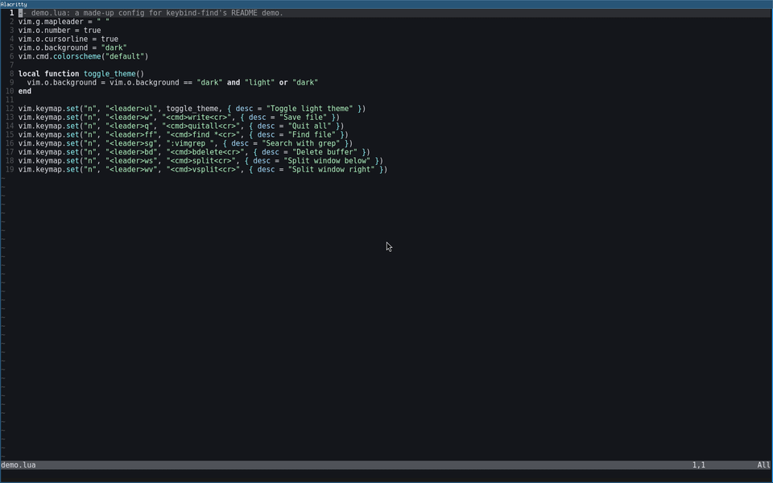

# keybind-find

Press one hotkey and get a searchable list of the keyboard shortcuts that work **where you are right now**: your
window manager's, the focused app's (nvim, tmux, herdr, alacritty, a web app) and your espanso snippets. Pick one
and keybind-find presses those keys for you, so it works as a command palette that also shows you the key you could
have pressed instead.

The lists are read from the programs' real configuration, your own bindings included, so nothing is kept up by hand.



## Works with

| Where | What is read | Setup |
|---|---|---|
| xmonad | your keymap, with each binding's name, and xmonad's stock keys | a few lines in `xmonad.hs`, incl. `ewmh`: [docs/xmonad.md](docs/xmonad.md) |
| sway | your `bindsym` lines (following `include` and `set $var`), and the focused window from sway's tree | none |
| Hyprland | its binds from the running compositor (`hyprctl -j binds`), with each bind's description, and the focused window from `hyprctl` | none ([below](#hyprland)) |
| KDE Plasma | its global shortcuts (`kglobalshortcutsrc`) and the launch shortcuts of `.desktop` files, and the focused window (on Wayland from `kdotool`) | on Wayland, `kdotool`; picks there are sent through the desktop's portal, after one approval ([below](#kde-plasma)) |
| i3 | the bindings of the config i3 has loaded (`i3-msg -t get_config`; from 4.20, includes followed and variables replaced by i3) | none ([below](#i3)) |
| Xfce | xfwm4's window shortcuts and your application shortcuts, from `xfconf-query` (X11) | `xfconf-query` ([below](#xfce)) |
| GNOME | its window, shell, mutter and media-key shortcuts, your custom shortcuts and the overlay key, from `gsettings`; on X11 also the focused window | `gsettings`; on Wayland picks are sent through the desktop's portal, after one approval, and the list opens in fzf ([below](#gnome)) |
| sxhkd (bspwm, or any X11 window manager) | the hotkeys of your running sxhkd, from the config files it loaded, with each one's comment, `{a,b}` sequences expanded and chains as key sequences | none ([below](#sxhkd)) |
| awesome | its keys from the running awesome over D-Bus (the hotkeys its own popup shows), with each key's description and group | none for the stock config; your `rc.lua` must `require("awful")` ([below](#awesome)) |
| Openbox (alone, or under LXDE or LXQt) | the keybinds of the `rc.xml` Openbox loaded, each with its actions, chains as key sequences, grouped under the comments that head them | none ([below](#openbox)) |
| any other X11 window manager (qtile, dwm, …) | the focused window, so every app below works; not the window manager's own keys, but sxhkd's when it runs | an EWMH window manager (it sets `_NET_ACTIVE_WINDOW`) |
| niri | its binds from your `config.kdl` (following `include`), each with its `hotkey-overlay-title` or else its action, and the focused window from `niri msg` | none; niri's own binds are listed, not sent ([below](#niri)) |
| other Wayland compositors (river, labwc, wayfire, …) | espanso only: the focused window isn't read, so no app below | untested |
| alacritty | its keys: alacritty's defaults merged with your `[[keyboard.bindings]]` | none |
| Ghostty | its keys from `ghostty +list-keybinds`, as your config sets them | none ([below](#ghostty)) |
| WezTerm | its keys from `wezterm show-keys`, as WezTerm reads your `wezterm.lua` (defaults, key tables, leader), and the program in its focused pane | none ([below](#wezterm)) |
| kitty | its default shortcuts for its version (0.49.2 built in) with your `kitty.conf` maps on top | none; the program in a tab needs remote control ([below](#kitty)) |
| foot | its default key, search and URL bindings for its version (1.28.0 built in) with your `foot.ini` on top, and its text bindings | none ([below](#foot)) |
| Xfce Terminal | its menu and scrolling shortcuts: xfce4-terminal's defaults for its version (1.2.0 built in) with your `accels.scm` on top | none ([below](#xfce-terminal)) |
| Konsole | its shortcuts: Konsole's defaults (26.08.2's built in) with your Configure Keyboard Shortcuts changes, shortcut scheme and profile shortcuts on top | none ([below](#konsole)) |
| GNOME Terminal | its keyboard shortcuts as its preferences set them, from `gsettings` (not on GNOME under Wayland, where the window isn't read) | `gsettings` ([below](#gnome-terminal)) |
| zellij | its keys in every mode, each tagged with its mode (`input_mode`): the installed zellij's keybinding preset (from 0.46) or default keys (before), with your `config.kdl` on top | none ([below](#zellij)) |
| nvim | your maps from a headless nvim with your config, with each map's `desc` | none |
| Emacs | the keys active in the buffer you are in, from the running Emacs over its server, with its major mode and evil state; with no server, the global map (and evil's) of your init file from `emacs --batch` | `server-start` in your init, or `emacs --daemon`, for the live read ([below](#emacs)) |
| vim | your maps (`:map`, `:map!`, `:tmap`, `:lmap`): asked of the running vim when it has a server (with its buffer's maps, mode and filetype), else from a headless vim with your vimrc; not vim's built-in keys | none; without a server it runs your vimrc ([below](#vim)) |
| nano | its main-menu keys: nano's defaults for its version (7.2, 8.4 and 9.2 built in) with your nanorc's `bind`/`unbind` on top | none ([below](#nano)) |
| micro | its keys: micro's defaults for its version (2.0.11, 2.0.14 and 2.0.15 built in) with your `bindings.json` on top | none ([below](#micro)) |
| Midnight Commander | its keys by section (file manager, panel, editor, viewer, …): mc's compiled-in defaults (4.8.33's built in) with the system and your keymap on top | none ([below](#midnight-commander)) |
| yazi | its keys: yazi's default keymap for its version (25.4.8, 25.5.31 and 26.9.1 built in) with your `keymap.toml` merged in | none ([below](#yazi)) |
| ranger | its file-browser keys: ranger's default rc.conf (1.9.4's built in, the same since 1.9.3) with `/etc/ranger/rc.conf` and yours on top | none ([below](#ranger)) |
| lf | its keys in normal, visual and command-line mode, from the running lf when it has them, else lf r42's defaults with your `lfrc` on top | none ([below](#lf)) |
| lazygit | its keys by panel, as its own keybindings cheatsheet lists them: lazygit 0.66.2's defaults with your `config.yml` and the repo's `.git/lazygit.yml` on top | none ([below](#lazygit)) |
| nnn | its keys as built (nnn 5.3's), plus the plugin (`;` + key) and bookmark (`b` + key) keys of the running nnn's `NNN_PLUG` and `NNN_BMS` | none ([below](#nnn)) |
| Kakoune | its keys by mode (normal, goto, view, object, insert, prompt, user modes): Kakoune's built-in keys (2026.05.21's built in) with the running session's mappings on top, else your kakrc and autoload files' | none ([below](#kakoune)) |
| helix | its keys in normal, select and insert mode: helix's default keymap for its version (25.01.1 and 25.07.1 built in) with your `config.toml` keys merged in | none ([below](#helix)) |
| ncmpcpp | its keys: ncmpcpp's defaults (0.10.1's built in, the same since 0.9.2) with your `bindings` files on top | none ([below](#ncmpcpp)) |
| herdr | herdr's defaults for its version, your `config.toml` and plugin commands | none |
| tmux | the running server's `list-keys`, so your prefix and bindings, with each key's note | none |
| GNU screen | its default command keys for its version (4.9 and 5.0 built in) with `/etc/screenrc` and your screenrc's `bind`, `bind -c` and `escape` on top | none ([below](#screen)) |
| bash, zsh, fish | the prompt's line-editing keys from the shell itself: bash's `bind -p`/`-s`/`-X` (with your `.inputrc`), zsh's `bindkey -L`, fish's `bind` (every mode) | none; it runs your rc files: [below](#shells-run-your-rc-files) |
| less | its keys from `less --help`, with your lesskey file's `#command` binds on top; also under `man`, `git log`, `systemctl status` | none; your keys need less 582+ and the lesskey source file ([below](#less)) |
| mpv | the bindings of a headless mpv started with your config: built-ins, your `input.conf` and keys your scripts bind at load, with each one's comment | none; it starts mpv on every `Super+/` ([below](#mpv)) |
| zathura | its keys: zathura's defaults for its version (0.5.2, 0.5.11 and 2026.10.23 built in) with your zathurarc's `map`/`unmap` on top | none ([below](#zathura)) |
| VS Code, VSCodium, Code - OSS | the default keys (1.143.1's built in), your installed extensions' and your `keybindings.json` on top, each tagged with where it works; the file's language guessed from the title | none ([below](#vs-code)) |
| Zed | its default keymaps (1.25.3's built in) for your base keymap and vim or helix mode, with your `keymap.json` on top, each tagged with its context; the file's extension guessed from the title | none ([below](#zed)) |
| qutebrowser | its bindings by mode, asked of the running browser (defaults, `config.py`, `autoconfig.yml`, `:bind`s, as `qute://bindings` lists them) with the mode it is in; else 3.7.0's defaults with your `autoconfig.yml` on top | none ([below](#qutebrowser)) |
| Obsidian | its default hotkeys (1.14.5's built in) with your vault's `.obsidian/hotkeys.json` on top, the vault picked by window title | none ([below](#obsidian)) |
| st, surf, tabbed, dwm | their stock keys from `config.def.h` at st 0.9.3, surf 2.1, tabbed 0.9 and dwm 6.8 (dwm's in a dwm session, whatever window has focus); a patched `config.h` isn't read: replace the sheet with your own of the same name | none ([below](#suckless-st-surf-tabbed-dwm)) |
| browsers | built-in sheets for Gmail, YouTube and GitHub; any web app you write a sheet for | none; GitHub's needs a URL-in-title extension ([docs/sheets.md](docs/sheets.md)) |
| Firefox / Chromium keys | the browser's own shortcuts (tabs, navigation, find, dev tools) in Firefox, LibreWolf, Zen, Chromium, Chrome, Brave and Edge, from built-in sheets | none ([below](#firefox-and-chromium)) |
| Vimium | Vimium's defaults for its version, and your remaps from a saved backup | none; remaps need the backup ([docs/vimium.md](docs/vimium.md)) |
| espanso | `espanso match list`; picking a match types its trigger | none |
| anything else | a sheet you write, or a script that prints one; a global sheet (`"provider": "*"`) lists things with no key, such as macros, that a pick runs (`"run": [argv]`) | [docs/sheets.md](docs/sheets.md) |

nvim, vim, Emacs (and `emacsclient -t`), nano, micro, mc (and mcedit, mcview, mcdiff), yazi, ncmpcpp, ranger, lf, lazygit, nnn, Kakoune (`kak`), helix, herdr, tmux, zellij, screen, the shells and less are read when they are the program in the focused terminal window: alacritty, kitty, foot,
WezTerm, st, xterm/uxterm, Ghostty, GNOME Terminal, Konsole, Xfce Terminal, urxvt or Terminator (by window class, or
sway `app_id`, Hyprland `class`); nvim also inside a herdr, tmux or zellij pane or a screen window. When one terminal process runs several shells
(tabs, splits, or several windows from one process: alacritty's daemon mode, `foot --server`, `urxvtd`; by default
GNOME Terminal, Konsole, Xfce Terminal, WezTerm, Ghostty and Terminator), keybind-find finds the focused one on X11 when the
terminal puts the window's id in each shell's environment (`WINDOWID`: Xfce Terminal, kitty, urxvt, alacritty), every
window of that process runs one shell, and each of those windows still exists (`xdotool search --pid`: a tab dragged
to another window keeps its old id; after tabs are swapped between two windows whose other tabs then close, each
window still names the other's program, and a tab held open after its command exits has no shell to count, so its
window gets its other tab's program); otherwise (tabs anywhere in that process, or a Wayland window) it prints a one-line warning and shows the list without
the program inside (the terminal's own keys, alacritty's, Ghostty's, WezTerm's, kitty's, foot's, GNOME Terminal's, Konsole's or Xfce Terminal's, are still listed).
kitty can say which tab has focus when its remote control is on ([below](#kitty)), and WezTerm can for its local panes ([below](#wezterm)). espanso's `word: true` matches (they
wait for a space or punctuation after the trigger) and regex matches (no literal trigger) can't be typed, picks do nothing while the espanso service is stopped, and matches limited by `filter_exec` aren't
listed.

### Shells run your rc files

Over a shell prompt, keybind-find starts your shell as `bash -ic`, `zsh -ic` or `fish -ic` on every `Super+/`, so
**your rc files run each time** (`.bashrc`, `.zshrc`, `config.fish`): whatever they start, they start again. The
shell gets 3 seconds; an rc file that takes longer, or `exec`s another program (`exec tmux`), is killed and the shell
is left out with a one-line warning. keybind-find sets `KEYBIND_FIND=1` for it, so you can skip slow or noisy parts:

```sh
[ -n "$KEYBIND_FIND" ] && return   # bash or zsh: put it after your binds, before the slow part
# fish: wrap the slow part in  if not set -q KEYBIND_FIND; ...; end
```

For fish it also sends the `fish_prompt` event (fish loads its bindings on the first prompt), so your prompt's event
handlers run too.

What it can't see: binds you made by hand in the running shell, binds a plugin adds later (zsh plugins that bind in
a hook or on first use), and an `INPUTRC` or `bind` set only in a login profile. For bash and zsh it shows the keymap
in force when the rc files are done: in vi mode that is insert mode (`viins`, bash's `vi-insert`), not command mode.
The shell it starts is the one on keybind-find's `PATH` (your window manager's), which may not be the one in the
terminal if you installed another. A script running in the terminal (`bash build.sh`) looks like a shell, so the
prompt's keys show then too.

### less

less is shown whenever it is any program in the terminal's foreground job, so it shows under `man`, `git log` and
`systemctl status` too, as well as the program that started it when keybind-find reads that one (a shell running a
script that pipes into less). Your keys are read from the lesskey **source** file less reads: `$LESSKEYIN`, else
`$XDG_CONFIG_HOME/lesskey`, `~/.config/lesskey` or `~/.lesskey`. Only its `#command` section is used; `#version`
lines are ignored. Before less 582, `lesskey` compiled your keys into a binary `~/.less`; a compiled file (`~/.less` or
`$LESSKEY`) is never read, on any version: you get less's defaults and a one-line note. Debian's `man` runs less
as `pager`, which is recognised too. `LESSKEYIN` and `XDG_CONFIG_HOME` come from keybind-find's environment (your
window manager's), not the shell's, so a value set only in an rc file isn't seen.

### mpv

mpv is shown when its window is focused (window class `mpv`, or the Flatpak's `io.mpv.Mpv`), not when mpv plays
inside a terminal. On every `Super+/` keybind-find starts mpv headless (`--vo=null --ao=null --idle=once`: no window,
no sound, no file) with your config, so **your scripts load each time**, as at any mpv start, and a heavy config makes
the list slower; mpv gets 3 seconds. It never takes over your player's `input-ipc-server` socket or `log-file`. The
bindings are those of an idle mpv: keys a script binds later, while a file plays (uosc and similar), exist only in the
running player and aren't listed. Mouse and wheel bindings and keys bound to `ignore` are left out. A Flatpak-only
mpv isn't run (keybind-find needs `mpv` on `PATH`), but when mpv finds no config directory of its own
(`$XDG_CONFIG_HOME/mpv` or `~/.config/mpv`, or `~/.mpv`), the Flatpak's (`~/.var/app/io.mpv.Mpv/config/mpv`) is
used.

### zathura

In a zathura window, keybind-find lists zathura's keys by mode (`normal`, `index`, `presentation`, `fullscreen`,
`insert`): the defaults of your zathura's version (from `zathura --version`; 0.5.2, 0.5.11 and 2026.10.23 are built in,
generated from zathura's and girara's source at each tag; another version uses the nearest of the same major version,
else the nearest older, and says so), with the `map` and `unmap` lines of the zathurarc files zathura reads laid over
them, in its order: `zathurarc` in each `$XDG_CONFIG_DIRS` directory (else `/etc/xdg`) from the last, `/etc/zathurarc`,
then your `~/.config/zathura/zathurarc` (or under `$XDG_CONFIG_HOME`; the Flatpak's under
`~/.var/app/org.pwmt.zathura` when that one doesn't exist: native zathura's windows carry the Flatpak's app id too, so
the window can't tell them apart), following `include` (each file is read once, where zathura reads a file again each time
it is included). As in zathura, a `map` with a function or mode zathura doesn't know changes nothing, and a line with an
unclosed quote ends its file there (counted in one line). A fullscreen key that does the same as in normal mode is
listed once, under `normal`. Each key shows its function and argument as a zathurarc line says them (`scroll down`,
`focus_inputbar :open`; a default's argument with no zathurarc name in brackets: `zoom (original)`). Not listed: mouse
binds (yours are counted in one line, as are keys girara refuses, such as two modifiers in `<C-S-x>`). Not read: a
config dir given with `zathura -c`/`--config-dir`, and for the Flatpak, its runtime's `/etc` (the host's is read).

### VS Code

In a VS Code window (Visual Studio Code, Insiders, VSCodium or Code - OSS, recognised by its window class; the title's
product name says which), keybind-find lists VS Code's default keybindings for Linux, pinned for 1.143.1 (one version,
not checked against yours, since that would mean running VS Code's CLI on every press), then the keybindings your
installed extensions contribute, then your `keybindings.json` (`~/.config/<Code|Code - Insiders|VSCodium|Code - OSS>/User/`,
or under `$XDG_CONFIG_HOME`, or the Flatpak's). As in VS Code, a `-command` rule (yours, or one an extension
contributes) removes that command's default and extension binds (those whose key is its key or starts with it, and whose `when` is its `when` as written, any when it
gives none or `true`; never your own), wherever it stands in the file. A rule
with the same key and `when` as an earlier one is listed in its place (VS Code would also let it shadow binds whose
`when` it covers; those stay listed). Each bind's `when` clause becomes scopes: `editorTextFocus` shows as
`[editorTextFocus=true]`, `!editorReadonly` as `[editorReadonly=false]`, `editorLangId == rust` as `[filetype=rust]` (`resourceLangId` and `resourceExtname` follow whichever view has focus, the editor's file or the explorer's selection, so they stay tags);
parts that can't be a scope (`!=`, regexes, `in`, comparisons) are dropped, so a bind is shown in more places, never
fewer, and binds VS Code never runs on Linux (a `when` of `false`, or one that needs `isMac`, `isWindows` or `isWeb`)
aren't listed. A key you bind to no command does nothing, so the default it replaces isn't listed either. With the keybind-find extension (below) the file's language and
extension come from VS Code itself; without it they are guessed from the window title, which needs VS Code's default `window.title` (the file first, the product name
last); with no editor open the folder name is taken for a file name. Only the default profile's `keybindings.json` is
read. Extensions come from `~/.vscode/extensions` (Insiders `~/.vscode-insiders`, VSCodium and Code - OSS
`~/.vscode-oss`, or the Flatpak's), those its `extensions.json` lists; disabled ones are still listed (VS Code keeps
that in a database). Keys keybind-find can't name (`[IntlBackslash]`, the browser keys), `when` clauses it can't read
and extensions whose `package.json` doesn't parse are counted in one line.

**The keybind-find extension** (`editors/vscode/`, two files, no build step) tells keybind-find the language
(`editorLangId`, as `filetype`) and the extension of the file open in the focused window, exactly, with any
`window.title`. To install it, copy the folder from this repository and restart VS Code:

```sh
rm -rf ~/.vscode/extensions/keybind-find.keybind-find-0.1.0
cp -r editors/vscode ~/.vscode/extensions/keybind-find.keybind-find-0.1.0
```

(`~/.vscode-insiders/extensions/` for Insiders, `~/.vscode-oss/extensions/` for VSCodium and Code - OSS.) It writes
one small file per window, `$XDG_RUNTIME_DIR/keybind-find/vscode/<pid>.json`, when the window's focus, editor or
language changes, and deletes it when the window closes; it makes no network calls and runs nothing. The language is
the active text editor's (the Output panel is one), and stays the last one while the terminal has focus. Snap and Flatpak builds keep their runtime
directory to themselves, so there keybind-find falls back to the window title. It can't report the
rest of VS Code's context: no extension can read context keys, so focus keys (`editorTextFocus`, `terminalFocus`),
the `resource*` keys and other extensions' keys (VSCodeVim's mode) stay tags. It isn't on the Marketplace or Open VSX
yet.

### Zed

Over a Zed window (app id or X11 class `dev.zed.Zed`, or its `-Preview`, `-Nightly` and `-Dev` channels), keybind-find
lists Zed's keys without running Zed: the Linux keymaps of Zed 1.25.3 built in
([data/zed/1.25.3/](data/zed/1.25.3), GPL-3.0-or-later, as Zed's assets), loaded as Zed loads them. That is the
default keymap, then your `base_keymap`'s (VS Code, JetBrains, Sublime Text, Atom, Emacs or Cursor; `Zed` and
`TextMate` add none, `None` loads no defaults at all), then Zed's vim keymap when `vim_mode` or `helix_mode` is on,
then Zed's specific overrides, then your `keymap.json` on top. A bind of yours replaces the one before it with the same key and the same context, and
`null` removes it; an `unbind` (or `zed::Unbind`) removes the binds of that key to that action, in its context (in
any, with none). A binding whose action isn't Zed's shape is left out with a line, as Zed does. Both files are read from `~/.config/zed/` (`$XDG_CONFIG_HOME/zed/`), or the Flatpak's
`~/.var/app/dev.zed.Zed/config/zed/` when the first doesn't exist; a file that doesn't parse is one line and is left
out. Only one Zed version is built in, and Zed updates itself weekly: keys a newer Zed added or moved are missing
until keybind-find's copy is updated. AI bindings that `disable_ai` would hide are listed.

Each bind's `context` is shown as tags: `Editor` as `[Editor=true]`, `!menu` as `[menu=false]`, `extension == md` as
`[extension=md]`, vim's `vim_mode == normal` as `[mode=normal]` and Zed's own `mode == full` as `[editor_mode=full]`;
for `A > B` only `B`'s; an `||` keeps what both sides share, and `!=` or a negated group none. So a tag says where a
bind works, never more narrowly than Zed. The facts are `os=linux` (so `os == windows` binds are hidden) and the
file's `extension`, taken from the window title in
Zed's default format (`project — main.rs`), which hides the keys of other file types (`extension == md`). The guess
needs the default `window_title_format`: one without ` — ` gives no fact, and one that doesn't end in the file name
gives a wrong one. Keys Zed binds that keybind-find can't send (`fn-`, a lone `shift`,
`shift-` with a non-letter, media keys such as `copy`) are left out with a count.

### qutebrowser

Over a qutebrowser window (X11 class `qutebrowser`, Wayland app id `org.qutebrowser.qutebrowser`), keybind-find asks the
running browser for its bindings: it finds qutebrowser's IPC socket among the window process's sockets (any
`--basedir`, the Flatpak), writes a short script of its own into a new `0700` directory beside that socket (in
qutebrowser's runtime directory) and sends `:debug-pyeval --file <that directory>/ask.py` over the socket, as a second
`qutebrowser` command would. The script lists the bindings exactly as `qute://bindings` does (the defaults however
changed, `config.py`, `autoconfig.yml` and `:bind`s made since) with the mode the browser is in, writes them to one file
in that directory, and keybind-find removes the directory. Only the current mode's bindings are shown (the mark and
macro modes use the `register` bindings): the mode of qutebrowser's last-focused window, the one under `Super+/`.
qutebrowser runs a command sent over its socket in the window `new_instance_open_target_window` picks (by default that
same last-focused window) and, unless `new_instance_open_target` is `tab-silent` or `tab-bg-silent`, raises and
activates it: with `first-opened` or `last-opened` and several windows, another window can come up. For the same
reason `keybind-find dump qutebrowser` from a terminal never asks the browser. A browser too slow to answer still runs
the command later, after keybind-find removed the script: it shows one error in its status bar.

When the browser doesn't answer within 2 s (or the script fails, say in a qutebrowser whose `:debug-pyeval` changed),
one line says why and keybind-find lists qutebrowser's defaults for the installed version (3.7.0's built in, from
qutebrowser's source) with `autoconfig.yml`'s bindings (`bindings.commands`) on top, as qutebrowser lays them over: the
file is read by the Python on the `#!` line of the `qutebrowser` on `PATH`, with PyYAML as qutebrowser loads it, which
also gives the version (that run has 2 s more, so a slow browser and a slow Python take up to about 4 s; a
`#!` line that doesn't run `python…`, or a `qutebrowser` not on `PATH`, as for the Flatpak, is one note and the newest
built-in defaults). `config.py` is Python, so its bindings are read only from the running browser: when it exists,
only the defaults are listed, with a note. The fallback reads `$XDG_CONFIG_HOME/qutebrowser` (else
`~/.config/qutebrowser`): the Flatpak's config (`~/.var/app/org.qutebrowser.qutebrowser/config`), `--basedir` and
`--config-py` aren't followed there, and an `autoconfig.yml` of a format other than version 2 gives the defaults alone.

Not listed: `bindings.key_mappings` (aliases such as `<Ctrl-[>` for `<Escape>`); keypad keys (`<Num+…>`) and Qt keys
with no X keysym (`<Guide>`), counted on one line. A private directory path holding `{…}` would be expanded by
qutebrowser's command runner (keybind-find makes its own under qutebrowser's runtime directory, so it holds none). Each
command is shown as written, never run.

### Obsidian

In an Obsidian window (class or app id `obsidian`, or `md.obsidian.Obsidian`, Obsidian's desktop name and the
Flatpak's id), keybind-find lists Obsidian's command hotkeys: the defaults of Obsidian 1.14.5 (read from that
release's app bundle; Obsidian isn't run, so its version isn't checked and every version gets these), with the
focused vault's `.obsidian/hotkeys.json` on top, as Obsidian uses it: a command you gave hotkeys has only yours, and
one you cleared has none. Your vaults are listed in `obsidian.json`, the first found of `$XDG_CONFIG_HOME/obsidian`
(else `~/.config/obsidian`, as for the AppImage), the Flatpak's `~/.var/app/md.obsidian.Obsidian/config/obsidian` and
the Snap's `~/snap/obsidian/current/.config/obsidian`; the first found is used, even when it is an older install's.
The window title (`<note> - <vault> - Obsidian <version>`) names the vault; with one vault it is that one, and with
several and a title that names none (a pop-out window), or two vaults sharing that folder name, you get the defaults
and a one-line note. A plugin's hotkey is listed under the plugin's id; it, and a command with no default hotkey that
you gave one, are described by their command id. Only the `.obsidian` config folder is read (a vault set to another
config folder keeps that inside Obsidian), and only command hotkeys are listed: keys that aren't commands, such as
the editor's own (CodeMirror's), aren't.

### Firefox and Chromium

A Firefox window (also Firefox Developer Edition, LibreWolf and Zen, and their Snap and Flatpak builds) lists
Firefox's own shortcuts; a Chromium, Google Chrome, Brave or Edge window lists Chromium's. Vivaldi and Opera have
keymaps of their own and get neither. The keys are those of the version named in the sheet's title
([data/sheets/firefox.json](data/sheets/firefox.json), [chromium.json](data/sheets/chromium.json)), as the browser's
support page lists them for Linux; another version may differ. They are left
out on a tab where a web-app sheet applies (Gmail, YouTube, GitHub or a `.json` sheet of yours with a `window_title`;
their loose title matches, such as `github.com` on `docs.github.com`, count too), and in an installed Chromium,
Brave or Edge app (PWA) window, on Wayland (by its class) and X11 alike (on X11 by its `WM_CLASS` instance,
`crx_<app id>`). A `--app=URL` window isn't told apart anywhere and still gets them, as does an app window in
XWayland under Hyprland (`hyprctl` doesn't report the instance). Brave and Edge get Chromium's keys, LibreWolf and
Zen Firefox's, which they share; their own extra keys (Zen's workspaces, say) aren't listed. To replace
one, put a `firefox.json` or `chromium.json` in your sheets folder ([docs/sheets.md](docs/sheets.md)): it turns the
built-in sheet off for the whole family, but applies only by its own `provider`, as any sheet does (`firefox` is
Firefox's window class only; LibreWolf or Zen need a sheet with their class).

### suckless (st, surf, tabbed, dwm)

These programs are configured by editing `config.h` and recompiling, so keybind-find can't read your keys: it ships
the stock ones, from each release's `config.def.h`
([data/sheets/st.json](data/sheets/st.json), [surf.json](data/sheets/surf.json),
[tabbed.json](data/sheets/tabbed.json), [dwm.json](data/sheets/dwm.json)). st's apply in a window of class
`st-256color` or `St` (or that instance, as with `st -c scratchpad`), surf's in `Surf`, tabbed's in `tabbed`; a surf or st embedded in tabbed is part of tabbed's
window, so only tabbed's keys show there. dwm's apply in a dwm session (by its `_NET_WM_NAME`, or the `dwm` process when `wmname` changed that), beside the focused
window's, and on an empty desktop too. If you patched `config.h`, copy the built-in sheet into
your sheets folder under the same name (`st.json`, `dwm.json`, …) and edit it ([docs/sheets.md](docs/sheets.md)): it
replaces the built-in one and applies where it did, whatever its `provider`. For st, surf and tabbed a parser named
after the window class (`st-256color`, by class only) that reads your `config.h` works too; it adds to the built-in sheet, so
replace that with an empty one.

There is no dmenu sheet: dmenu grabs the keyboard and is never the focused window, so `Super+/` can't open over it
and a picked key couldn't reach it.

### Emacs

Over Emacs in a terminal (`emacs`, `emacs-nox`, `emacs-gtk`, `emacs-lucid`, `emacs-pgtk`, or `emacsclient -t`), or an
Emacs window (class or Wayland app id `emacs`), keybind-find asks the running Emacs over its server socket
(`emacsclient --eval`, 2 seconds) for the keys active in the selected window's buffer: every keymap Emacs would look a
key up in, in its order (minor modes, the major mode's map, the global map), each key once, as the one that runs.
Global keys carry no tag; the major mode's carry `major-mode=<mode>`, and those of minor modes and other maps
`buffer=current`. The buffer's major mode (`major-mode`) and, with evil on in it, its state (`mode`: `normal`,
`insert`, `visual`, …) are facts, so the keys of another major mode or evil state are hidden. The socket is found from
the command line (`--daemon=NAME`, `--fg-daemon=NAME`, emacsclient's `-s NAME`) or among the sockets in Emacs's server
directory (`$XDG_RUNTIME_DIR/emacs`, else `/tmp/emacs<uid>`; for `emacsclient` without `-s`, its default `server`
first); an Emacs with no server (no `(server-start)` in your init) is read as below without a note, and a socket that
doesn't answer (also a stale one left by an Emacs that crashed) is one line. A remapped command (`[remap …]`, as
counsel or consult set up) is listed as the command that runs. A TCP server (`server-use-tcp`) isn't asked.
`ALTERNATE_EDITOR` is removed for this, so no daemon is ever started.

With no server to ask (or `keybind-find dump emacs` from a shell), keybind-find runs `emacs --batch` with your init
(`early-init.el`, your installed packages, then `~/.emacs`, `~/.emacs.el` or `init.el` in `~/.emacs.d` or
`~/.config/emacs`) on every `Super+/`, and lists the global map and, when your init loads evil, evil's normal, insert,
visual and motion state maps (tagged `mode=<state>`); buffer and mode keys need the running Emacs. Your init runs as at
any start (packages it installs, too) but with `server-start` turned off and `kill-emacs-hook` cleared, so it can't
touch a running Emacs or write recentf, savehist or desktop files; `after-init-hook` and `emacs-startup-hook` don't
run, so keys set up there (`:hook (after-init . evil-mode)`) are missing. It gets 10 seconds, and an error in it is one
line, with the keys it set up before that listed. Doom Emacs and Spacemacs need their own startup: their init isn't loaded, and only Emacs's own global map
is listed, with one line saying so. Mouse, menu and tool-bar entries, the `[remap …]` entries themselves, keyboard macros and lambdas aren't
listed, and keys keybind-find can't send (hyper or `A-` modifiers, a key with no X keysym such as `<again>`) are left
out with a count.

### vim

Over vim or vi in a terminal, or a gvim window (class `Gvim`), keybind-find first asks the running vim, when it runs a
server: `--remote-expr` for its maps (`:map`, `:map!`, `:tmap`, `:lmap`), its mode and its buffer's filetype, with the
running vim's own executable as the client. Then the list has the buffer's own maps (tagged `buffer=current`) and
maps you made by hand, and the maps of other modes are hidden. vim needs `+clientserver` (`vim --version`) and a
server: gvim starts one by itself; a terminal vim only when started with `--servername NAME` (an alias such as
`alias vim='vim --servername VIM'`) or when its vimrc calls `remote_startserver('VIM')`, unless it was built with
`+autoservername`. Arch's `vim` has the socket backend (`+socketserver`, vim 9.1.1651 and later); Debian trixie's
`vim` (9.1.1230) has no clientserver, its `vim-gtk3` the X11 one. Servers that don't answer within 2 seconds in all are a one-line note and
the headless read; servers that are all other vims' mean this one has none. (A vim inside tmux or screen isn't read: only nvim is, there.) Without a server,
keybind-find starts vim headless (`vim -es`) with your
vimrc (`~/.vimrc`, `~/.vim/vimrc` or `~/.config/vim/vimrc`, the first that exists) on every `Super+/` and lists your
maps, each tagged with its modes. Your vimrc and plugins run, as at any vim start (but not `VimEnter` autocommands,
so maps made there are missing); vim gets 10 seconds. A vimrc that prints or has an error is fine: the maps are read all the same. With no vimrc you get what a
plain vim start sets (`defaults.vim`). vim's own keys aren't listed: they are vim's documentation's (`:help index`),
and your maps are what you forget. Left out: plugins' `<Plug>` and script-local maps; and from the headless read,
buffer-local maps (a headless vim has no file of yours open), maps made by hand in the running vim, the system vimrc's (`/etc/vimrc`), `$EXINIT`
and `~/.exrc` (with no vimrc), and a gvim's `.gvimrc` and `has('gui_running')` branches. `~/.config/vim/vimrc` is
read as vim 9.1.0327 and later read it; an older vim ignores it. vim run as `vimdiff`, `view` or `rvim` isn't
recognised. `HOME`, `XDG_CONFIG_HOME` and `VIMINIT` are keybind-find's (your
window manager's environment), not the running vim's; when `VIMINIT` is set, vim reads it instead of a vimrc, and
keybind-find says so and shows nothing for vim. The `vim` on `PATH` is run (else `vi`, Debian's vim-tiny): a `vim`
that is nvim gets nvim's list, and a vim without `+eval` (vim-tiny) is a one-line note. Over a `vi` that is another
editor (ex-vi, busybox), the list is still `vim`'s.

### nano

Over nano or rnano in a terminal, keybind-find lists nano's main-menu keys: the defaults of your nano's version
(from `nano --version`; 7.2, 8.4 and 9.2 are built in, taken from nano's source at each tag; another version uses
the nearest of the same major version, else the nearest older, and says so), with the `bind` and `unbind` lines of
`/etc/nanorc` and then your nanorc (the first readable of `~/.nanorc`, `$XDG_CONFIG_HOME/nano/nanorc`,
`~/.config/nano/nanorc`) laid over them, for the `main` and `all` menus, as nano reads them: a key name or a function
nano doesn't take changes nothing, and a bind to a macro or to another menu's function takes the key away. Macros and
other menus are not listed. `include` lines are checked (a missing file is a one-line note), but nano reads only
syntax definitions from included files, so they change no key. The defaults are a normal build's with no options:
`--modernbindings`, `--rcfile` and the like aren't read, rnano is shown with nano's keys, and a nano built with
another system nanorc than `/etc/nanorc` has that file's binds missed.

### micro

Over micro in a terminal, keybind-find lists micro's keys by pane type (`buffer`, `command`, `terminal`): the Linux
defaults of your micro's version (from `micro -version`; 2.0.11, 2.0.14 and 2.0.15 are built in, generated from micro's
source at each tag; another version uses the nearest older one of the same major version (else a newer one of it), else
the nearest older, else the oldest, and says so) with your `bindings.json` on top, as micro reads it: from
`$MICRO_CONFIG_HOME`, else `$XDG_CONFIG_HOME/micro`, else `~/.config/micro`; comments and trailing commas allowed (other
JSON5, such as single quotes, isn't); a top-level `"key": "action"` binds in `buffer`, an object named after a pane
binds there, and `"None"` unbinds. Two spellings of one key replace each other as in micro (`CtrlS` and `Ctrl-s`); keys
micro tells apart stay apart, even where the terminal sends the same thing (`Ctrl-m` and `Enter`). Each key shows its
action as written (`Copy|CopyLine`, `command:pwd`). A `bindings.json` that doesn't parse is one line, and micro's
defaults are shown; mouse keys, raw escapes, keys micro or keybind-find can't read and values that aren't strings are
left out, counted in one line. Not read: keys bound by Lua plugins (unless written to `bindings.json`), and a config dir
given with `-config-dir`.

### Midnight Commander

When mc, mcedit, mcview or mcdiff is the program in the focused terminal, keybind-find lists mc's keys, one category per
keymap section (`filemanager`, `panel`, `editor`, `viewer`, `viewer:hex`, …), built as mc builds its keymap: mc 4.8.33's
compiled-in defaults, then `/usr/share/mc/mc.keymap` and the system keymap (`$MC_DATADIR/mc.keymap`, else
`/etc/mc/mc.keymap`), then **one** user keymap: `$MC_KEYMAP`, else the `keymap` value in `[Midnight-Commander]` of
`~/.config/mc/ini`, else `~/.config/mc/mc.keymap` (or under `$XDG_CONFIG_HOME/mc`). Distros install mc's full default
keymap as `/etc/mc/mc.keymap`, so another mc version's keys show for every action that file names (actions only
4.8.33 compiles in still show). A name without `.keymap` gets it, and a relative one is looked for in `~/.config/mc`,
then `/usr/share/mc`. A later file replaces an action's keys, and `Action =` removes it; a key two actions name in one
section shows on the first, as mc uses the first. Keys in a `:xmap` section follow the key that opens it
(`ExtendedKeyMap`, `ctrl+x c`): the first of its keys that no earlier action in that section has. When every one is
taken, as `WordRight` takes the editor's `ctrl-x` by default, mc never opens the map and its keys aren't listed (a key
bound in a section mc consults first, such as `[panel]` before `[filemanager]`, isn't checked). A line mc's keyfile reader can't read ends the file there, with a
one-line note; a misspelt action is listed as written; key names keybind-find can't name (including ones mc can't read,
such as the `ctr-a` in mc's own default keymap) are left out and counted in one line.

Not seen: a keymap given with `mc -K`, and `MC_KEYMAP` or `MC_DATADIR` set only in the shell that started mc
(keybind-find has its own environment, from your window manager). While mc's subshell is in front (Ctrl-O) the terminal
still reports mc, so mc's keys are listed, not the shell's. MinIO's client is also called `mc`; in a terminal running
it you get Midnight Commander's list.

### ranger

Over ranger in a terminal, keybind-find lists its file-browser keys without running it: the `map`, `copymap` and
`unmap` lines of ranger's default rc.conf (from 1.9.4, unchanged since 1.9.3, built in, its `eval` loops written out),
then `/etc/ranger/rc.conf`, then yours (`$XDG_CONFIG_HOME/ranger/rc.conf`, else `~/.config/ranger/rc.conf`), read
into ranger's key tree as ranger does: a later line wins, binding `g` drops `gg` and the reverse, `copymap` copies
what the key has at that line. Only the browser's keys are listed (not the console's `cmap`, the pager's `pmap` or
the task view's `tmap`), with the command as the description and its first word as the category. When
`RANGER_LOAD_DEFAULT_RC` is `false` the defaults are left out, as ranger does; that variable, like `HOME` and
`XDG_CONFIG_HOME`, is read from keybind-find's environment, not ranger's, and a config directory given with `-r`/`--confdir` isn't read. `source` lines
(an absolute path or `~/…`), `chain` and `alias` are followed. Your `eval` lines aren't run (they are counted), nor
is any command. Keys keybind-find can't send (`<any>` bookmark keys,
`<bg>`, a `<number>` key code) are left out with a count; an unknown `<name>` is its characters, as in ranger.

### lf

Over lf in a terminal, keybind-find lists lf's keys in normal, visual and command-line mode, each tagged with its mode
(a key bound to the same command in normal and visual mode is one entry with both), described by the command as lf
writes it (`set hidden!`, `:{{ toggle; down; }}`, `${{ mimeopen --ask "$f" }}`) and filed by its first word (`shell`
for a shell command, `list` for a `:` list). It asks the running lf first, with `lf -remote "query <pid> maps"` and
`cmaps`: lf's own list, with everything your `lfrc`, `-command`s, hooks and typed `map`s did, as of the last shell
command lf ran. lf fills that list only when it runs a shell command (opening a file with the default `open`, `:maps`,
an `on-cd` or `on-init` hook), so a fresh lf that hasn't run one yet, an lf started with `-single` (no server) or one
that doesn't answer within a second
is read from its config instead, with a line saying why (nothing for the fresh lf). keybind-find sends lf nothing.

The config read is lf r42's built-in keys (built in), then the files lf loads, as lf reads them: with `-config FILE` on
lf's command line only that file, else `/etc/lf/lfrc` and `$LF_CONFIG_HOME/lf/lfrc` (else `$XDG_CONFIG_HOME/lf/lfrc`,
else `~/.config/lf/lfrc`), then each `-command`. The flags, `LF_CONFIG_HOME`, `XDG_CONFIG_HOME` and `HOME` come from
the focused lf's process (keybind-find's own environment for `keybind-find dump lf`); lf itself takes your home from
the password database, which differs only when `HOME` was changed. A relative path (`-config my.lfrc`, `source
rel.lfrc`, a relative `LF_CONFIG_HOME`) is taken from lf's current directory, which is the one you have browsed to, not
the one lf started in. `map`, `nmap`, `vmap`, `cmap`, `map KEY` with nothing after it (how lf deletes a key),
`clearmaps`, `source` and top-level `:` lists are followed;
hooks and shell commands are never run. A file lf would stop reading at a syntax error stops there too, with one line.

Left out, with a count: pointer events (`<m-up>`, lf's default wheel keys), keys lf never reads from the keyboard
(`<f-36>` and up, `<upleft>`, an unknown `<name>`), in normal and visual mode a key starting with a digit (lf reads it
as a count), a key with `<esc>` after its first key, and a key whose shorter start is itself bound (lf runs the shorter
one at once: `Q` hides `Qa`); in command-line mode a key of more than one key, and a character without alt (lf types
it, so the default `<space>` isn't listed). `<c-h>`, `<c-i>`, `<c-m>` and `<c-j>` are listed and sent as ctrl+h etc.;
many terminals send BackSpace, Tab and Return for them, which lf reads as those keys. While lf runs a `$` or `!`
command (an editor from `e`, a pager from `i`, a shell from `w`), lf's keys aren't listed: that program is in front.
Its previewer, its cleaner and programs a command left running in the background don't read the terminal, so lf stays
listed while they run.

### lazygit

Over lazygit in a terminal, keybind-find lists the rows of lazygit's own keybindings cheatsheet (what its `?` menu and
docs show), filed under their panel (`Files`, `Commits`, `Global keybindings`, `List panel navigation`, …), each key
one entry described by the row's action, with the config key that sets it (`universal.quit`) as its command. The
defaults are lazygit's for your version (asked of the focused lazygit's own binary, `/proc/<pid>/exe --version`, else
of `lazygit --version` on PATH; 0.66.2's are built in, the nearest is used with a note for another version). On top come the `keybinding:` sections of the files lazygit reads, in lazygit's order: the
files `--use-config-file`/`LG_CONFIG_FILE` names (comma-separated, in order; a missing one gets a line), else
`config.yml` in `--use-config-dir`/`CONFIG_DIR`, else the first `jesseduffield/lazygit/config.yml`, then the first
`lazygit/config.yml`, in `$XDG_CONFIG_HOME` (else `~/.config`) then each `$XDG_CONFIG_DIRS` directory (else
`/etc/xdg`); then the repo's files, as lazygit reads them on entering a repo: `.lazygit.yml` in each directory above
the repo, the outermost first (the repo's own `.lazygit.yml` isn't read, as lazygit doesn't), then
`.git/lazygit.yml` (the main repo's for a linked worktree), found with `git rev-parse` in lazygit's directory. The
flags, the variables and the directory come from the focused lazygit's process (keybind-find's own for `keybind-find
dump lazygit`). Each field a file sets replaces the default's keys; a legacy `-alt` field (`quit-alt1`, …) adds its
keys to the main one, so `quit: X` gives `X` and `<ctrl+c>`, as in lazygit. `<disabled>`, an empty value and `null`
unbind; a row left with no key isn't listed. lazygit re-reads its files when they change, so this is what it uses.

The files are YAML, and keybind-find reads only their `keybinding:` section, with a small reader of the YAML lazygit's
own docs use there: nested `key: value` lines, plain and quoted values, one-line `[a, b]` lists and `{ a: b }`
mappings, `- a` lists (also at the key's own column) and comments (the rest of the file is skipped unread). Inside `keybinding:` anchors, aliases,
tags, `|` and `>` blocks, a list or mapping over several lines, a duplicate key, a mapping where keys belong, a
section or `keybinding:` itself left empty (lazygit refuses its null), and anywhere in the file a top-level value
going on to the next lines, an indented or flow document, a directive other than `%YAML 1.1` and `%TAG`, a control
character, a lone CR or a Unicode line break, or text that isn't UTF-8 make
keybind-find skip that file's keys, with one line naming the file and line; the other files still count. A section
or key lazygit doesn't have gets one line and is ignored, as lazygit ignores it (an old name lazygit renames when it
loads a file, such as `executeCustomCommand`, is one: lazygit writes the new name back into the file). There is no
oracle: lazygit prints only its defaults (`lazygit --config`), so the built-in sheet is checked against lazygit's
cheatsheet instead.

Left out, with a count: `meta` keys (the terminal decides what that is, and keybind-find can't send it to the
terminal), the mouse wheel rows, characters with no keysym, and keys lazygit refuses (one stops lazygit loading its
whole config: that file gets a line, and its other keys are listed as written). Custom commands (`customCommands:`) aren't listed yet. Only the Linux
defaults are built in: with `LAZYGIT_KEYBINDING_PLATFORM=darwin`, the six keys that differ on macOS show their Linux
default. A repo given with `--git-dir`, lazygit started inside a `.git` directory and bare repos read no repo files.
lazygit is found as the program in the terminal, not inside a tmux, zellij or screen pane or nvim's terminal
(lazygit.nvim). While lazygit runs an editor (`e`), a shell command (`:`) or a pager, its keys aren't listed: that
program is in front.

### nnn

Over nnn in a terminal, keybind-find lists nnn's keys under its help screen's sections (`NAVIGATION`,
`FILTER & PROMPT`, `FILES`, `MISC`). nnn's keys are compiled in, so they are its stock key table for your version
(`nnn -V`, asked of the focused nnn's own binary, else `nnn` on PATH; 5.3's is built in, the nearest is used with a
note for another version): a build with changed keys (`O_COLEMAK`, an edited `nnn.h`) isn't seen. On top come your
plugin keys, `; <key>` under `PLUGIN KEYS` (described by the plugin, without nnn's leading `-`), and bookmark keys,
`b <key>` under `BOOKMARKS`, from `NNN_PLUG` and `NNN_BMS` as the running nnn read them: from its own environment
(`/proc/<pid>/environ`; keybind-find's own for `keybind-find dump nnn`, with a note). They are read as nnn reads them:
a malformed `NNN_PLUG` gives no plugin keys (nnn runs none), a malformed `NNN_BMS` no bookmark keys (nnn won't start
with it), each with one line; a key with no keysym (a control or non-ASCII byte) is left out with a count. Plugin
commands and paths are shown, never run. Not listed: Esc and Alt+key (nnn reads them by timing, outside its key
table), and the second keys nnn's help doesn't list (`b ,`, `b Return`, `; Return`). With type-to-nav on (`-n`, `n` in
`NNN_OPTS`, or `^N`), a picked letter is typed into the filter: press Esc first. While nnn runs a plugin, a `!` shell,
the editor or the pager, its keys aren't listed: that program is in front. nnn is found as the program leading the
terminal: started from the shell, by nnn's `n` function or a script that `exec`s it; a wrapper script that runs nnn
as a child leads instead, so nnn isn't found.

### Kakoune

Over `kak` in a terminal, keybind-find lists Kakoune's keys by mode: its built-in keys for your version (2026.05.21's,
from Kakoune's source: the normal-mode commands with their own descriptions; the goto, view and object menus; the
insert and prompt keys, worded as `:doc keys` words them) with your mappings on top, a mapping replacing the built-in
key of its mode and key. Kakoune doesn't say which mode a client is in, so every mode's keys show, each tagged with
the mode it is typed in: a goto, view, object or user mode key as the sequence that reaches it from normal mode (`g
q` and `shift+g q`, `v z` and `shift+v z`, `alt+i q` and `alt+a q`, `space x`; object's keys aren't repeated after
its other leads, `[`, `]`, `{`, `}`, their `alt+` forms, `alt+shift+i` and `alt+shift+a`); an insert, prompt, menu or combine key alone; a user mode your config
declares (`declare-user-mode`) under its own name, without the key that enters it (keybind-find can't know it). When
your config maps one of those leading keys in normal mode, the sub-mode's keys follow the normal mapping that runs
exactly that key (with `map global normal , <space>` and `map global normal <space> ,`, user keys are at `comma
x`), and are left out with a count when none does. A mapping is described by its docstring, else its keys.

The mappings come from the running session: keybind-find finds the session of the kak in front (`-c`, `-C` or `-s`
on its command line, else its pid) and sends it a short script with that kak's own binary, `kak -p`. In the client
whose pid that is, the script writes a marker, `debug mappings` and an end marker to `*debug*`, then copies `*debug*`
and Kakoune's version to a private directory in kak's `$XDG_RUNTIME_DIR`, else keybind-find's own, whichever is
yours and closed to others (with neither, the session isn't asked), which keybind-find reads and removes. The script
then empties its command. So every map the session has counts: your kakrc, autoload
plugins, filetype hooks and window and buffer maps. Each Super+/ adds those lines to your `*debug*` buffer and leaves
one hidden command, `keybind-find-report-<pid>` (doing nothing), defined in the session (Kakoune can't remove a command); nothing
else in the session changes. A session renamed with `rename-session` can't be found: keybind-find knows only the name
on kak's command line, and Kakoune renames the socket file while the kernel keeps listing it under its first name
(`/proc/net/unix`), so finding it would mean asking other sessions. When the session can't be asked (renamed, no
private runtime directory, no answer within 2 s), one line says why and keybind-find reads your config instead, as Kakoune sources it at start:
every `*.kak` under `<config>/autoload` (else the runtime's `autoload`; Kakoune takes them in directory order, which
keybind-find approximates by name), then the runtime's `kakrc.local`, then `<config>/kakrc` unless `kakrc.local`
failed, all of it only when the runtime has its `kakrc` (`<config>` is `$KAKOUNE_CONFIG_DIR`, else `$XDG_CONFIG_HOME/kak`, else `~/.config/kak`). Their commands are split as
Kakoune parses them and `map`, `unmap`, `declare-user-mode`, `try` and `evaluate-commands` are followed; a command
Kakoune refuses at start (`map window …`) ends that file, as in Kakoune. Not read, since they need Kakoune running:
`hook` and `define-command` bodies, `source`, and any command with a `%sh{}`, `%val{}`, `%opt{}` or other expansion
(such a `map` is counted on the left-out line). `keybind-find dump kakoune` from a shell reads the config. A non-ASCII
key keybind-find can't name and focus events are left out with a count. `ctrl+i`, `ctrl+m`, `ctrl+[` and
`ctrl+shift+` a letter reach Kakoune as themselves only in a terminal that reports keys in the kitty protocol Kakoune
asks for (kitty, foot, Ghostty and others); elsewhere they can arrive as Tab, Return, Escape and `ctrl+` the letter.

### helix

Over helix in a terminal (`hx`, or `helix` as Arch installs it), keybind-find lists its keys in normal, select and
insert mode, each tagged with its mode, filed under the sub-mode that holds it (`Goto`, `Space`, `Window`, `View`,
…). The defaults are helix's keymap for your version (from `hx --version`; 25.01.1's and 25.07.1's are built in, the
nearest is used with a note for another version, and the newest when helix isn't found), described by each
command's own doc. Your `$XDG_CONFIG_HOME/helix/config.toml` (else `~/.config/helix/config.toml`, else the Flatpak's)
is merged as helix merges it: a table onto a sub-mode adds to it, anything else replaces the key, a list of commands
is one bind, `no_op` removes a key, a `:typable` command is described by its doc (or `:name args` with arguments) and
an `@macro` by its keys. A config with bad TOML or a key, mode or command helix doesn't know gives helix's defaults and
one line saying why, as helix does; the options under `[editor]` aren't checked.
The workspace's `.helix/config.toml` isn't read (keybind-find doesn't know helix's directory), and keys keybind-find
can't send (`null`, media keys, lone modifiers) are left out with a count.

### ncmpcpp

Over ncmpcpp in a terminal, keybind-find lists its keys without running it: ncmpcpp's defaults (from 0.10.1's source,
unchanged since 0.9.2, built in) with your bindings on top, read as ncmpcpp reads them:
`$XDG_CONFIG_HOME/ncmpcpp/bindings` (`~/.config/ncmpcpp/bindings`), then `~/.ncmpcpp/bindings`. A key you bind loses
its defaults; several `def_key` blocks for one key are alternatives, shown in order (`play item / toggle output`), and a
key bound only to `dummy` isn't listed. At an error ncmpcpp won't start with (an invalid key, a line it doesn't know, a
key with no actions), keybind-find stops reading (the second file too, as ncmpcpp does), with one line naming the
file and line: the running ncmpcpp read the file before it changed. `mouse` and keys no press reaches (`shift-a`,
`ctrl-alt-x`, `shift-enter`: ncmpcpp reads shift and ctrl only with the arrows, insert, delete, home, end and the page
keys, and shift with tab) aren't listed. Action names aren't checked, so a misspelled one is listed as written. The paths come
from keybind-find's environment (`HOME`, `XDG_CONFIG_HOME`), not ncmpcpp's. Files given with
`-b`/`--bindings` on ncmpcpp's command line aren't read. One list for every screen: in ncmpcpp a key runs the first of
its alternatives that can run where you are, so an alternative may do nothing on the current screen.

### yazi

Over yazi in a terminal, keybind-find lists yazi's keys by section (`mgr`, `input`, `tasks`, …; `manager` before yazi
25.5.28): the default keymap of your yazi's version (from `yazi --version`; 25.4.8, 25.5.31 and 26.9.1 are built in,
yazi's own `keymap-default.toml` at each tag; another version uses the nearest of the same year, else the nearest older,
else the oldest, and says so: 25.5.28 to 25.5.30 get 25.4.8's, with `manager` where they have `mgr`, so there your
`[mgr]` is ignored too) with your `keymap.toml` merged in as yazi merges it. It is read from `$YAZI_CONFIG_HOME`, else
`$XDG_CONFIG_HOME/yazi`, else `~/.config/yazi`. Per section, `keymap` replaces the defaults, `prepend_keymap` goes first
and replaces the defaults on the same first two keys, and `append_keymap` goes last unless a default has those keys; an
entry for another platform (`for = "macos"`; before 26.x also `for = "all"`) or one that runs `noop` (how yazi unbinds a
key) isn't listed, and of two on the same keys only the first is, as yazi runs the first. A section your yazi doesn't
have (`[manager]` from 25.5.28 on) is named in one line and ignored, as yazi ignores it. A `keymap.toml` yazi would
refuse (not TOML, an entry without `on` or `run`, a key with a modifier yazi doesn't know, from 26.x a `for` it doesn't
know, a section that isn't a table) is one line, and yazi's defaults are shown. A key with no keysym keybind-find knows
is left out, counted in one line. Not read: keys plugins or `init.lua` change at runtime; a plugin bound in
`keymap.toml` (`run = "plugin foo"`) is listed by its `run`.

### Hyprland

Under Hyprland, keybind-find asks the running compositor for its binds (`hyprctl -j binds`) and never reads your
config (from Hyprland 0.56 it is Lua). A bind shows its `description`, or else its dispatcher and argument
(`exec kitty`); in a 0.56 Lua config without a description that is only the dispatcher's name (`exec_cmd`) or
`lua function`, so give binds a `description` to find them by what they do. Binds are grouped by dispatcher. A bind in
a submap is tagged with it (`[submap=resize]`), since keybind-find can't tell which submap is active. Mouse and wheel
binds, catch-all binds, binds by keycode (`code:NN`), long-press binds, key names that aren't keysym names, and binds
in a submap whose name has spaces or other characters a scope name can't hold can't be sent or scoped, and are left
out, counted in one line. Caps Lock and Num Lock in a bind's modifiers are ignored. The
focused window comes from `hyprctl -j activewindow`, never from X, so a native Wayland window is never mistaken for the
last XWayland one; if `hyprctl` fails, that is a line for the window and one for the binds, and the list goes
on without them.

### niri

Under niri, keybind-find reads the config file niri reads: `$NIRI_CONFIG` when set, else
`$XDG_CONFIG_HOME/niri/config.kdl` (`~/.config/niri/config.kdl`), else `/etc/niri/config.kdl`. niri removes
`NIRI_CONFIG` from the environment of what it starts, and its `--config` isn't visible, so a config elsewhere is
followed only when `NIRI_CONFIG` is set in keybind-find's own environment. The file is read as niri 26.04 reads it (KDL
1, through the `kdl` crate): `include "file"` is read in place (relative to the including file, `~/` from your home;
`optional=true` with no file is skipped quietly), and a later `binds` block replaces an earlier bind of the same key,
as niri merges them. A bind shows its `hotkey-overlay-title` (Pango markup removed), or else its action as written
(`spawn alacritty`, `focus-column-left`); binds are grouped by action. `Mod` is your `input { mod-key }` (Super by
default); a nested niri (one running as a window) uses `mod-key-nested` instead, which keybind-find doesn't read.
Mouse, wheel and touchpad binds, Mod3 (`ISO_Level5_Shift`) binds and unknown modifiers are left out, counted in one
line. Two binds that come out as the same keys (`Mod+T` and `Super+T` when `mod-key` is Super) are both listed, with
a line saying so: niri runs only the first. Where niri refuses the whole config, keybind-find says so in one line and
lists the rest, for example: a missing include, a file that includes itself, includes 10 or more levels deep, a key
bound twice in one `binds` block (the first is kept), a second `binds` block in one file (merged), a bind with several
actions (the first is shown). keybind-find also skips, with a line, a file over 4 MiB and includes past the 256th. A file that isn't valid KDL drops niri's binds, with a line naming it. The Alt+Tab binds of
niri's `recent-windows` section are not listed. Nothing in the config is run: `spawn` commands are only shown.

The focused window comes from `niri msg --json focused-window`, never from X. An X11 app under xwayland-satellite has
the satellite's pid, so the program inside an X11 terminal isn't found there. Picking an app's key sends it with
`wtype`, as under sway. Picking one of niri's own binds is refused with the key to press: wtype's virtual keyboard
delivers keys to the focused window, never to niri's bind handling, so the key would reach the app, not niri.
keybind-find doesn't run the bind's action (`niri msg action`) instead: a pick only ever sends keys.

### screen

GNU screen can't print its key table, so keybind-find takes screen's default command keys for its version (from
`process.c` `InitKeytab()` of 4.9.1 and 5.0.2; another version gets the nearest, with a one-line note) and lays
`/etc/screenrc` and then your screenrc (`$SCREENRC`, else `~/.screenrc`, as keybind-find's own environment has them)
over them, following `source`: `bind` adds, replaces or removes a key, `escape`/`defescape` moves every key behind your
command key, and `bind -c <class>` keys are listed behind the key that enters the class (`bind r command -c resize`).
Not read: `-e` or `-c` on screen's command line, a system screenrc built in somewhere other than `/etc/screenrc`,
`$SYSSCREENRC`, `bindkey` and `bind -k` lines (counted in the one-line note), and per-user `escape` in multiuser
sessions. nvim inside screen is found through the one attached session (`screen -ls`) and its current window; with
several attached sessions keybind-find can't tell which is yours, says so in one line, and shows screen's keys without
nvim's. A session shared by several terminals (`screen -x`) answers for one of them, which may not be the focused one.
A window renumbered with `number` may not be found. Other programs inside screen aren't looked for.

### Ghostty

In a Ghostty window, keybind-find asks `ghostty +list-keybinds --plain`, which reads your config files (and their
`config-file` includes) as Ghostty does, so the list is what the config on disk says: a change you haven't reloaded
yet is already shown. Without a config file it asks for the defaults (`--default`), since a plain `+list-keybinds`
would write a template config for you. Binds are grouped by action. A bind in a key table (Ghostty 1.3+,
`resize/h=…`) is tagged with it (`[key_table=resize]`), since keybind-find can't tell which table is active.
Binds with `global:`, `all:`, `unconsumed:` or `performable:` are listed without that prefix: `+list-keybinds`
doesn't print it. `catch_all`, non-ASCII keys, keys with no X keysym and key tables whose name can't be a scope are
left out, counted in one line. Ghostty 1.2+ names keys by their place on a US keyboard (`key_q`, `digit_1`), and
keybind-find shows and sends that key's US symbol, so on another layout (AZERTY, Dvorak) such a bind may be on a
different key. Started from the desktop, Ghostty runs every window, tab and split in one process
(`gtk-single-instance`), and it has no command that names the focused one, so the program inside (nvim, a shell) is
found only when that process runs one shell; otherwise you get Ghostty's keys and the one-line warning above. A
window whose class you changed (Ghostty's `class` option) isn't recognised as Ghostty.

### WezTerm

In a WezTerm window, keybind-find asks `wezterm show-keys`, and WezTerm finds and runs your config as it does on start
(`WEZTERM_CONFIG_FILE`, `~/.wezterm.lua`, `~/.config/wezterm/wezterm.lua`), so the list is WezTerm's defaults (unless
`disable_default_key_bindings`) with your `keys` on top, as WezTerm resolves them; keybind-find never reads
`wezterm.lua` itself. Binds are grouped by action. A bind in a key table (`key_tables`, and the `copy_mode` and
`search_mode` tables WezTerm always has) is tagged with it (`[key_table=copy_mode]`), since keybind-find can't tell
which table is active. A `LEADER` bind is listed as a sequence, the leader first (`ctrl+a c`). WezTerm lists some
defaults under several spellings (`CTRL W`, `SHIFT | CTRL W`, `SHIFT | CTRL w`); spellings that come out as the same
key with the same action are listed once (`ctrl+shift+w`), while pairs that differ after the notation, such as
`ctrl+exclam` and `ctrl+shift+exclam`, both show. Left out,
counted in one line: `ENHANCED_KEY` binds (only ones WezTerm makes itself: that modifier in your `wezterm.lua` makes
the config fail to load), keys with no X keysym (media keys, raw key codes, non-ASCII keys), key
tables whose name can't be a scope, and `LEADER` binds with no leader set. WezTerm prints a bind on Delete as `Escape`,
so it is listed (and sent) as Escape.

A `wezterm.lua` that fails to load (a syntax error, or a call such as `wezterm.gui.screens()` that needs a window)
makes `show-keys` print WezTerm's defaults with no error, so keybind-find lists the defaults and says nothing; a
WezTerm started with that config runs on its defaults too, and shows the error in its own window. A WezTerm started
with `--config-file` elsewhere isn't followed: keybind-find reads the config your environment points to.
`show-keys` runs without `DISPLAY` or `WAYLAND_DISPLAY` and from `/`, so a `wezterm.lua` that branches on those (or on
the working directory) may list different keys than the running WezTerm has.

WezTerm runs every window, tab and split from one process; keybind-find finds the program in the focused pane (nvim,
a shell) by asking WezTerm, with nothing to configure: `wezterm cli list-clients` (1 s limit) on the socket named in
the panes' environment (`WEZTERM_UNIX_SOCKET`) says which pane the window's process has focused, on X11 and Wayland
alike. That needs `wezterm` on your `PATH` and a local pane: a pane of a mux server or of `wezterm connect` (another
domain) isn't followed. Right after you switch between WezTerm windows, WezTerm may still name the previous window's
pane for a moment (it records focus when the window repaints). Without an answer you get WezTerm's keys and the
one-line warning above. A Flatpak WezTerm has no `wezterm` on
your `PATH`, so its keys aren't listed (one line says so), and a window whose class you changed (`--class`) isn't
recognised as WezTerm.

### zellij

When zellij is the program in the focused terminal, keybind-find lists its keys in every mode, each tagged with the
mode it works in (`[input_mode=pane]`): zellij has no way to ask a client which mode it is in, so all are shown. They
come from the installed zellij (`zellij --version`), with your `config.kdl` applied on top as zellij applies it
(`clear-defaults`, `shared`, `shared_except`, `shared_among`, `bind`, `unbind`); the file is the one zellij finds:
`$ZELLIJ_CONFIG_FILE`, else `config.kdl` in `$ZELLIJ_CONFIG_DIR`, `~/.config/zellij`, `$XDG_CONFIG_HOME/zellij` or
`/etc/zellij` (a relative `$ZELLIJ_CONFIG_FILE` is taken from keybind-find's own working directory, not the
zellij client's).

- From 0.46, the defaults are the keybinding preset your `keybinds preset="…"` names (`default` when none), as
  `zellij setup --dump-keybinds=<preset>` prints it: one of zellij's built-in presets (`default`, `unlock-first`),
  else your `keybinds/<preset>.kdl` in zellij's default config directory. Its `{primary}`, `{secondary}` and
  `{unlock}` leader keys come from your `keybinds primary="…" secondary="…" unlock="…"`, else from the preset. A
  preset zellij can't print, your own preset with anything zellij would refuse in it, or leader keys that are empty,
  the same, or make a key invalid, give zellij's built-in `default` preset with its own leaders and a one-line note.
  In zellij's own built-in text, a mode, key, `{placeholder}` or instruction keybind-find doesn't know (a newer
  zellij's) is left out and counted in one line, unless the key holds a leader value you gave.
- Before 0.46, the defaults are the `keybinds` of `zellij setup --dump-config`.

A config zellij would refuse (a key or mode it doesn't know, a `clear-defaults` that isn't `true` or `false`, a KDL
error) gives one line naming the file and line, and no zellij keys. A key keybind-find can't send (a non-ASCII
character) is left out and counted in one line. Each bind's description is its actions as written
(`NewPane "Down"; SwitchToMode "Normal"`); they are shown, never checked. A bind with no actions (`bind "x" { }`)
hides the default for its key and isn't listed.

Not seen: keys a layout sets, `zellij options --keybinds-preset` (and `--keybinds-primary` and the rest) given for one
session, a client started with `--config`; and presets the running zellij would find but `--dump-keybinds` doesn't (in
`$ZELLIJ_CONFIG_DIR/keybinds` or a `keybinds_dir`, a preset given as a path, or your own `keybinds/default.kdl` in
place of the built-in one). Mouse binds are never listed. keybind-find reads its own environment and `PATH`, not the
zellij client's: `ZELLIJ_CONFIG_FILE`, `ZELLIJ_CONFIG_DIR` or `XDG_CONFIG_HOME` set only in your shell, a `zellij` that
isn't on the `PATH` of whatever starts keybind-find, or a client still running an older zellij after an upgrade, give
a different list than the running zellij has; and zellij's sessions are looked for in the socket directory from
keybind-find's own `ZELLIJ_SOCKET_DIR`, `XDG_RUNTIME_DIR` or `TMPDIR`.

nvim in zellij's focused pane is found from `zellij action list-clients`, its keys read from its config (not the
running nvim). zellij shows a pane running vi, vim or nvim on exactly one file (`FILE` or `+N FILE`) under the name
of its editor (`scrollback_editor`, else the server's `$EDITOR`, which config.kdl's `env` block can set, else
`$VISUAL`, else `vi`; an empty `$EDITOR` renames nothing) when that editor is itself vi, vim or nvim. So nvim on one
file is missed when that editor is vi or vim (vi when none is set), and with nvim as the editor a vi or vim pane on
one file is taken for nvim. Several sessions (detached ones count), several clients, no client attached, no client
listed (as while the pane's scrollback is open in the editor) or a zellij without `action list-clients` give one line
and only zellij's keys.

### kitty

In a kitty window, keybind-find lists kitty's default shortcuts for its version (from kitty's
`kitty/options/definition.py` at 0.49.2; another version gets the nearest, with a one-line note; with no `kitty` on
`PATH` or in `~/.local/kitty.app/bin`, the newest) with your `kitty.conf` on top, read as kitty reads it: the file in
`$KITTY_CONFIG_DIRECTORY`, else the first `kitty/kitty.conf` under `$XDG_CONFIG_HOME`, `~/.config`, then each
`$XDG_CONFIG_DIRS` entry (a config directory you can't write to, which kitty skips, is still read), following
`include` and `globinclude`. Either way the system file `/etc/xdg/kitty/kitty.conf`, when there is one, is read first
and yours on top. Your `map` lines replace or remove (`map <key>` with no action, or
`no_op`) the default on the same key, `kitty_mod` applies to every map that uses it, and `clear_all_shortcuts yes` drops
every map before it. A key in a keyboard mode (`map --mode resize …`) is tagged with it (`[keyboard_mode=resize]`), and
the key that enters the mode (`--new-mode`) is listed too. A default keeps kitty's title (`Copy to clipboard`); your
own map shows its action. Not read: `envinclude` and `geninclude` (it runs a program), noted in one line; left out and
counted in one line: `--when-focus-on` maps (they depend on the window, which keybind-find can't see), `hyper`,
`caps_lock` and `num_lock` modifiers, keys with no X keysym, and a mode name that can't be a scope.

kitty runs every OS window, tab and split from one process, so with more than one shell open keybind-find has to ask
kitty which one is focused before it can list the program inside (nvim, a shell). It asks only when kitty's remote
control is reachable from outside: put these in `kitty.conf` and restart kitty:

```
allow_remote_control socket-only
listen_on unix:@kitty
```

keybind-find then finds the address in a shell's environment (`KITTY_LISTEN_ON`) and runs `kitten @ ls` (1 s limit).
keybind-find never sends a password (so kitty never asks you to allow it), so with `allow_remote_control password`
it gets no answer. Without an answer you get kitty's keys and the one-line warning above, ending with the two lines to
add. Anything that can reach that socket can control kitty, as
kitty's own documentation warns.

### foot

In a foot window (app_id `foot`, or `footclient` in server mode), keybind-find lists foot's default bindings for its
version (from foot's `config.c` at 1.28.0, each described from foot.ini(5); another version gets
the nearest, with a one-line note; with no `foot` on `PATH`, the newest) with your `foot.ini` on top, read as foot
reads it: the first of `$XDG_CONFIG_HOME/foot/foot.ini` (else `~/.config/foot/foot.ini`) and each `$XDG_CONFIG_DIRS`
entry's `foot/foot.ini` (else `/etc/xdg/foot/foot.ini`), following `include=` (absolute or `~/`). `[key-bindings]`
are listed under `foot`, `[search-bindings]` under `search`, `[url-bindings]` under `url`, and `[text-bindings]` under
`text` as the text they send (`send \x1b[A`); `[mouse-bindings]` aren't read. A line of yours replaces every default
key of that action, and `action=none` removes it; a `pipe-*` command or `regex-*` name is shown with the action. A key
you give to an action while another still has it stays with the other, as in foot, which reports it as an error;
keybind-find says so in one line too. Left out and counted in one line: a modifier other than `Control`, `Shift`,
`Mod1`/`Alt` and `Mod4`/`Super`, a key name that isn't shaped like an X keysym (names aren't looked up), an upper-case
key with `Shift` (foot never fires it), and a line foot would refuse. An include cycle, or includes nested deeper than 8, stops with a note, as does a section name foot
doesn't know. Not seen: a config given with `foot -c` (or to `foot --server`), `-o` overrides, and a foot started
with another `--app-id` or `app-id=`, which isn't recognised as foot.

foot is Wayland-only, so its window is read under sway and Hyprland. A standalone foot runs one shell per window and
the program inside is found as in any terminal; `foot --server` serves every `footclient` window from one process, and
foot can't say which shell belongs to which window, so there you get the one-line warning and foot's own keys without
the program inside.

### Xfce Terminal

In an Xfce Terminal window (X11 class `Xfce4-terminal`, Wayland app id `xfce4-terminal`), keybind-find lists its menu
and scrolling shortcuts (`shift+Up`, `shift+Prior`, …): the defaults of your xfce4-terminal's version (from `xfce4-terminal --version`; 1.2.0's are built in, the
nearest is used with a note for another version, and the newest when it isn't installed) with your
`~/.config/xfce4/terminal/accels.scm` on top (the first found under `$XDG_CONFIG_HOME` or `~/.config`, then each
`$XDG_CONFIG_DIRS` entry, then `/etc/xdg`, as Xfce looks for it), which Edit → Preferences → Shortcuts writes: a changed shortcut replaces the default, an empty one removes
it. Shortcuts keybind-find can't send (`<Hyper>`, `<Meta>`) are left out with a count. xfce4-terminal runs one process
for all its windows: on X11 the program in the focused window is found by `WINDOWID` when no window of that process
has tabs; otherwise, or under Wayland, only Xfce Terminal's own shortcuts are listed.

### Konsole

In a Konsole window (X11 class `konsole`, Wayland app id `org.kde.konsole`), keybind-find lists Konsole's own
shortcuts (tabs, splits, copy and paste, find, fonts, monitoring, …). Konsole has no way to print them, so its
defaults are built in: Konsole 26.08.2's, with the KDE Frameworks 6.31 standard shortcuts it keeps and the window's
own (Find Action, What's This, Open Menu); one version, not checked against the installed Konsole. On top go the
changes you make in Settings → Configure Keyboard Shortcuts, which Konsole saves in
`~/.local/share/kxmlgui5/konsole/konsoleui.rc` and `sessionui.rc` (the first of each found under `$XDG_DATA_HOME` or
`~/.local/share`, then each `$XDG_DATA_DIRS` entry): a changed shortcut replaces the default, an empty one removes it,
and an action keybind-find doesn't know is listed by its name (a stale entry for an action Konsole no longer has
too). The file is read as it is: KXMLGUI's merging of an older or hand-written file with the shipped one isn't
modelled. A file that can't be read is one line, and the defaults
show. From `~/.config/konsolerc` (or under `$XDG_CONFIG_HOME`): a shortcut scheme other than Default (`[Shortcut
Schemes]`) starts from no shortcuts and applies `konsole/shortcuts/<scheme>` from the same data directories, as Konsole
does (without that file, or if it can't be read, a line says so and the list keeps only what doesn't come from a
scheme); the toolbar toggles' keys (`[Shortcuts]`, where Konsole saves them); your profile
shortcuts (`[Profile Shortcuts]`) are listed as `New tab with profile <name>`, which is what they do (one for a
profile you have since deleted too). Changes to the standard shortcuts made for all KDE apps (`kdeglobals`) aren't
read, nor a system-wide `konsolerc` in `$XDG_CONFIG_DIRS`. The Quick Commands and SSH Manager plugins' quick-access
keys are listed with their defaults: a key you set in their docks (kept in their own settings) isn't read. Of the keyboard layout (`.keytab`), only the
default layout's scrolling keys are listed (`shift+Prior`, `shift+Up`, …; they don't work while a full-screen program
such as vim runs); a profile using another layout isn't followed, and the rest of a layout is what keys send to the
program, not Konsole shortcuts. Keys keybind-find can't send (keypad keys) are left out, counted in one line.

Konsole runs every window and tab of one launch in one process. With a single shell the program inside is found as in
any terminal; with tabs (they share one `WINDOWID`) you get the one-line warning and Konsole's own shortcuts, without
the program inside.

### gnome-terminal

In a GNOME Terminal window (class `Gnome-terminal` on X11, app id `org.gnome.Terminal` under sway and Hyprland),
keybind-find lists its keyboard shortcuts, read with `gsettings list-recursively org.gnome.Terminal.Legacy.Settings`:
your changes from Preferences → Shortcuts over the installed defaults. Shortcuts set to disabled aren't listed, and
when shortcuts are turned off altogether the list has none of them and a one-line note says so. Not listed: the
terminal widget's own keys (such as `shift+Page_Up` scrolling), and F10 for the menu (an on/off setting, not a key). On GNOME under
Wayland the focused window can't be read, so GNOME Terminal's keys aren't shown there. One `gnome-terminal-server` runs
every window and tab and can't say which is focused, so with more than one tab or window open you get the one-line
warning and GNOME Terminal's own keys, without the program inside; with a single tab the program inside is found as
in any terminal.

### KDE Plasma

On Plasma, keybind-find reads the shortcuts kglobalacceld saves in `~/.config/kglobalshortcutsrc` (or under
`$XDG_CONFIG_HOME`), grouped by component (KWin, Plasma, Session Management, …), each shown by its friendly name.
Only shortcuts you have saved there are listed: a component that never wrote its shortcuts to the file isn't, since
the running kglobalaccel (over D-Bus) is not asked. Apps' launch shortcuts (`X-KDE-Shortcuts` in their `.desktop`
files under `kglobalaccel/` and `applications/`) are listed under `launch`, with your changes from the file on top.
Keys keybind-find can't send (keypad keys, a key Qt names but no X keysym matches, non-ASCII keys) are left out,
counted in one line. A modifier pressed alone (Plasma's launcher on `Meta`) is listed as `Super_L`.

On X11 the focused window is read with `xdotool` as on any X11 window manager. On Wayland it comes from
[`kdotool`](https://github.com/jinliu/kdotool) (Plasma 6; not in Arch's or Debian's repositories: AUR or
`cargo install kdotool`); without it, that is one line and the list has only Plasma's shortcuts and espanso.

On Wayland KWin doesn't offer the virtual-keyboard protocol that `wtype` needs, so a pick is sent through the
desktop's RemoteDesktop portal (`xdg-desktop-portal` with its KDE backend, which Plasma installs), keyboard only. The
first pick shows Plasma's dialog asking to allow remote control: allow it and tick the option to remember it, and
later picks are sent without asking (without it ticked the dialog shows on every pick). The approval is kept as a
restore token in `~/.local/state/keybind-find/portal-token` (`$XDG_STATE_HOME/keybind-find/portal-token`); delete
that file to revoke it, and the next pick asks again. Plasma shows a "Remote Control Started" notification, and a tray
item while the keys are sent, on every pick. A refused dialog or another portal failure ends with an error naming the
keys to press (`press super+e yourself`); a key name keybind-find doesn't know is refused before that, naming it
(`refusing to send "ctrl+Foo": no keysym "Foo"`). `--print` prints as anywhere else. The list shows with
fuzzel, which works on KWin.

Keys go as X keysyms, which the desktop looks up in your current layout (here and on [GNOME](#gnome)):

- A key or character your layout lacks, in a chord as in an espanso trigger: GNOME drops it with no error, so a
  `super+` chord with such a key (`super+XF86Launch0`) opens Activities instead; KWin types it through a keymap of
  its own for that key, but without the chord's modifiers, which can then stay held until you press and release them
  yourself.
- KWin lets go of `mod5` at once, so on KDE a `mod5` chord arrives without it.
- With Caps Lock on, an espanso trigger is typed with its letters' case swapped.
- Mutter can't reach a key's fourth level or above (AltGr+Shift: `Ł` on a Polish layout) and types that key's
  plain character instead.

### i3

Under i3, keybind-find asks the running i3 for the config it loaded (`i3-msg -t get_config`) and reads its
`bindsym` lines as sway's are read: top-level binds under `i3`, a mode's under the mode's name. The files on disk are
not read: i3 4.20 and newer reply with every file it included and its variables already replaced, so
`set_from_resource` values are right too; before 4.20 there is no `include`, keybind-find replaces the variables
itself (matching their case exactly, where i3 ignores case), and `set_from_resource` variables stay as written. `bindcode` lines (keycodes, with no key name to show or send) are left out, counted in one line. A key
bound twice, which i3 reports as an error, shows its last binding, while i3 runs the first. Without `i3-msg`, or with
no i3 answering, that is one line and the list goes on without i3's keys.

### awesome

Under awesome, keybind-find asks the running awesome for its hotkeys over D-Bus, the way `awesome-client` does
(`dbus-send` to `org.awesomewm.awful`, with a fixed Lua snippet that only reads). It lists what awesome's own hotkeys
popup (`Super+s`) reads: every key created with `awful.key`, global and client keys alike, each with its `description`
under its `group` (else `awesome`); the popup hides a key with no description, keybind-find shows it as
`no description`. Like the popup, that is every key ever created with `awful.key`, not only the ones installed now: a
key made again (per client in a `manage` handler, or when keys are rebuilt) is listed again, and a key created but never
installed is listed too. Your `rc.lua` is never read or run by keybind-find: awesome has already run it.

Modifiers show as `super` (Mod4), `alt` (Mod1), `ctrl` and `shift`; the number-row keycodes the stock config binds
tags to (`#10` to `#19`) show as `1` to `0`, as the popup labels them. Those keycodes are sent as the keys `1` to `0`,
so on a layout whose number row types other characters (AZERTY) the sent key may not be that key. An upper-case
letter key (`"J"`) is listed as `shift+j`, but awesome 4.3 matches keys by their unshifted symbol, so such a key, like
a shifted symbol (`"#"`), never fires there. A modifier name awesome doesn't know (`"Super"`, `"mod4"`) is ignored
by awesome, so the key fires without it; keybind-find drops it too and says how many keys had one. Keys with a `Mod2`,
`Mod3`, `Mod5`, `Lock` or `Any` modifier, any other keycode (`#94`), a key name keybind-find can't send (a non-ASCII
character, or a number of two or more digits, which awesome can't resolve), and entries that aren't one key
(awesome-git's key groups) are left out, counted in one line. Under awesome-git, a key made with one key (`keys =
{{"y"}}`) is read as awesome-git's popup reads it.

awesome answers only when your `rc.lua` loads `awful` (`require("awful")`, as the stock config does), awesome was
built with D-Bus, and keybind-find runs on awesome's session bus. Bind keybind-find with `awful.spawn("keybind-find")`,
not `os.execute` or `io.popen`: awesome runs one thing at a time, so while it waits for keybind-find it can't answer
it. Without any of that, without `dbus-send`, or when awesome doesn't answer in 2 s, that is one line naming the cause
and the list goes on without awesome's keys.

### Openbox

Under Openbox (alone, or as LXDE's or LXQt's window manager), keybind-find lists the keybinds of the `rc.xml` Openbox
loaded, found as Openbox 3.6.1 finds it: the file Openbox was started with (`--config-file`, as LXDE and LXQt start
it), which Openbox names in the root window's `_OB_CONFIG_FILE` property; else the first `openbox/rc.xml` of
`$XDG_CONFIG_HOME` (or `~/.config`) and `$XDG_CONFIG_DIRS` (or `/etc/xdg`), from keybind-find's own environment. A file
that exists but doesn't load is one line, and the next is tried; with none, Openbox's three built-in keys (`Alt+Tab`,
`Alt+Shift+Tab`, `Alt+F4`) are listed, as Openbox binds them. `keybind-find dump openbox` works without Openbox running.

Only the last `<keyboard>` counts, as in Openbox. Each keybind is listed with its actions as text (`GoToDesktop to=left
wrap=no`, `Execute xterm`), several joined by `;`; nothing is run. A keybind with nested keybinds is a chain, listed as
a key sequence (`super+a t`) and sent as one; `key="W-a W-b"` lists both keys. Keybinds are grouped under the last
comment before them inside `<keyboard>` (`<!-- Keybindings for windows -->`, as the stock `rc.xml` has; a comment
holding `<` is commented-out XML, not a title), else `openbox`. Modifiers show as `super` (`W`, `Super`, `Mod4`), `alt`
(`A`, `Alt`, `Mod1`), `ctrl` and `shift`; a single upper-case letter as its lower-case key, since Openbox binds its
key, unshifted. Left out, counted in one line: keys with a `Meta`, `Hyper`, `Mod2`, `Mod3` or `Mod5` modifier (which
can't be sent on X11), keycodes (`0x26`), an unknown modifier or key name (Openbox binds nothing for it), a keybind in
conflict with an earlier one (a key that is both a chain's start and a key of its own, which Openbox drops), and
`xi:include` elements.

Limits: Openbox has no command that prints its bindings, so the list is not checked against a report of Openbox's own
(the e2e test checks a key and a chain of its test config, and its demo the pick). The file is read as it is now: an
edit Openbox hasn't loaded yet (`openbox --reconfigure`) is listed early. The XML is read strictly: a file Openbox reads
with libxml2's error recovery is skipped here with its line, and a DOCTYPE with its own entities or an `xi:include`
isn't followed. A file over 4 MiB or with elements nested deeper than 256 (libxml2's own limit) is skipped, and after
5000 keys and actions (each key of a chain, each action each time it is bound) the rest are left out, in one line. An action name
Openbox doesn't know is listed, though Openbox binds nothing for it. A shifted symbol other than a letter (`W-exclam`)
is listed as written, but Openbox binds its key unshifted while the pick sends Shift with it, so it may not fire.

### sxhkd

On X11, whatever the window manager (bspwm has no keys of its own: they are sxhkd's), keybind-find lists the hotkeys
of each `sxhkd` you run, right after the window manager's keys. It reads the files that sxhkd loaded, found as sxhkd
finds them: `-c FILE` from its command line, else `$XDG_CONFIG_HOME/sxhkd/sxhkdrc` or `~/.config/sxhkd/sxhkdrc` from
sxhkd's own environment, then each extra config named after the options. Lines are read as sxhkd 0.6.3 reads them
(`#` only at the start of a line, `\` continuing a line), and `{a,b}` and `{1-9}` sequences are expanded as sxhkd
expands them, so `super + {_,shift + }{1-9,0}` lists twenty keys, each with its own command. A chain (`super + w ; a`)
is a key sequence (`super+w a`). A comment right above a hotkey is its description (with the command when it
expands to several keys); a comment block followed by a blank line is a section title, the category of the hotkeys
under it (so is a commented-out hotkey followed by a blank line); with neither, the category is `bspc`'s subcommand
(`node`, `desktop`) or `sxhkd`. Commands are shown, never run; a pick presses the key, which sxhkd then acts on.
Hotkeys with `hyper`, `meta`, `mode_switch`, `lock`, `mod2`, `mod3`, `mod5` or `any`, pointer buttons, an upper-case
letter, or a key name sxhkd doesn't know (names are case-sensitive: `Return`, not `return`; sxhkd drops those
hotkeys too) are left out, counted in one line. A hotkey bound in two files, or by two sxhkd, is listed twice, though only the
first grab fires. A file that can't be read is one line, and the others still
count. With no sxhkd running, `keybind-find dump sxhkd` reads the default path and says so. sxhkd prints no list of
its hotkeys, so there is nothing to check the list against but its files. Under Wayland sxhkd isn't listed.

### Xfce

On Xfce (X11), keybind-find lists the keyboard shortcuts from `xfconf-query -c xfce4-keyboard-shortcuts -l -v`:
xfwm4's window shortcuts under `window manager` (`<Alt>F4` → `close window`) and your application shortcuts under
`commands`, each shown by its command, which is never run. As Xfce does, each of the two uses your customized set
once you have changed it (`custom/override` is true), else Xfce's defaults. xfwm4's actions that work only while
moving a window or cycling windows (`cancel_key` and the arrow actions, on `Escape` and the arrows by default) are left
out. A shortcut keybind-find can't send (a modifier other than ctrl, shift, alt and super, such as `<Meta>`, `<Hyper>`
or `<Release>`; a keycode; or a key not shaped like an X keysym name, since names aren't looked up) is left out,
counted in one line. When `xfconf-query` is missing or fails (no D-Bus session to ask), that is one line and the list
goes on without Xfce's keys. Xfce's Wayland session runs another compositor, so there no Xfce shortcuts are listed.

### GNOME

On GNOME (X11 and Wayland, Ubuntu's session too), keybind-find lists the shortcuts from `gsettings list-recursively`
of five schemas: `org.gnome.desktop.wm.keybindings` under `window manager`, `org.gnome.shell.keybindings` under
`shell`, mutter's two under `mutter`, and the settings daemon's media keys under `media keys`. Each shortcut is
described by its key's name (`switch-to-workspace-left` → `switch to workspace left`); a key can have several. Your
custom shortcuts (Settings → Keyboard → Custom Shortcuts) are under `custom`, each by its name (else its command,
which is never run), and the overlay key (`Super`, shown as `Super_L`) under `shell`. The media keys' fixed hardware
keys (`*-static`) aren't listed. A schema that isn't installed is named in one line and the others are still listed;
mutter's `Above_Tab` (the key above Tab, whatever it is on your layout) and a shortcut keybind-find can't send (as for
[Xfce](#xfce)) are left out, counted in that line. Without `gsettings`, that is one line and the list goes on
without GNOME's keys.

On X11 the focused window is read as on any X11 window manager. On Wayland GNOME offers no way to read it (without
an extension), so the list has GNOME's shortcuts, espanso and your global sheets. Mutter doesn't offer the virtual-keyboard protocol that
`wtype` needs, so a pick there is sent through the RemoteDesktop portal (`xdg-desktop-portal` with its GNOME backend,
which GNOME installs), as on [KDE](#kde-plasma): the first pick shows a "Remote Desktop" dialog; switch on "Allow
Remote Interaction" (Share stays off until you do), keep "Remember This Selection" ticked, and later picks are sent
without asking. The token is the same file, and deleting it revokes the
approval. Keys are looked up in your layout as [on KDE](#kde-plasma). `--print` prints as anywhere else. The list opens in fzf in alacritty, an ordinary window
(fuzzel needs layer-shell, which Mutter lacks), with key search off as on any Wayland; without fzf or alacritty it
falls back to fuzzel, with one line saying to install them or set `[picker]` ([docs/picker.md](docs/picker.md)).

## Install

First, the programs keybind-find runs. They aren't built into it, and only the Nix package brings them along:

- **X11:** `xdotool`, `xprop`, `xmodmap`, `fzf` 0.66+ (0.60 runs the list, 0.66 adds key search), `alacritty`, and
  `notify-send` for errors shown under a hotkey
- **Wayland:** add `fuzzel` and `wtype` (not on GNOME, which uses fzf)

[install-deps.sh](install-deps.sh) installs them with your distribution's package manager (Arch, Debian/Ubuntu,
Fedora, openSUSE, Void, Alpine, Gentoo and their derivatives), and warns when your fzf is too old for key search. On
Gentoo, fuzzel and wtype come from the GURU overlay, which it tells you how to enable rather than enabling it:

```sh
curl -fsSL https://raw.githubusercontent.com/Benjmhart/keybind-find/main/install-deps.sh | sh
```

It asks for your password through `sudo`; read it first if you'd rather. The `.deb` recommends the X11 set, so apt
installs most of it anyway. Package names for each tool, and the optional ones, are under [Requirements](#requirements).

Then keybind-find itself, from source:

```sh
cargo install --path .
```

This puts `keybind-find` in `~/.cargo/bin`. Your window manager starts it, so that directory must be on the `PATH`
the window manager was started with, not only your shell's. If it isn't, use the full path in the binding below.

Other channels:

- a static binary and a `.deb` on the [GitHub release page](https://github.com/Benjmhart/keybind-find/releases)
- crates.io: `cargo install keybind-find`
- `cargo binstall keybind-find`: the release's static binary, without building (x86_64)
- Nix: `nix run github:Benjmhart/keybind-find`

## Bind it to `Super+/`

`Super+/` is free in stock xmonad (its help key is `Super+Shift+/`) and in sway, and it is easy to remember as "help".

- **xmonad:** follow [docs/xmonad.md](docs/xmonad.md). There, `Super+/` writes xmonad's keymap for keybind-find to
  read and then starts it.
- **sway:** `bindsym $mod+slash exec keybind-find` (with `$mod` set to `Mod4`).
- **i3:** `bindsym Mod4+slash exec keybind-find` (or `bindsym $mod+slash exec keybind-find` with `$mod` set to
  `Mod4`); i3's default config doesn't bind `Super+/`.
- **Anything else:** bind `Super+/` to run `keybind-find`.

Prefer another key? Change only that one binding; keybind-find doesn't care which key started it.

Under xmonad, float the picker window, centred and no larger than the screen: the `manageHook` line is in
[docs/picker.md](docs/picker.md).

## Using it

On X11 the list opens in fzf, in **key search**: press a binding's keys (Super combinations included) and the list narrows to the
bindings that start with them; Enter runs the highlighted one. **Escape** switches to typing to filter, `ctrl-k`
goes back to pressing keys, and `ctrl-s` picks which column you search. Typing letters straight away presses keys; press Escape first
to filter by text. On Wayland the list opens in fuzzel (on GNOME, in fzf with key search off): type to filter. The
bindings you pick most come first.

- [docs/picker.md](docs/picker.md): the picker, key search, and other pickers (`[picker]` in the config: rofi,
  kitty instead of alacritty, dmenu, wofi, fuzzel, or a JSON frontend of your own) and sizing the window
- [docs/config.md](docs/config.md): moving keybind-find's own keys in `config.toml`
- [docs/sheets.md](docs/sheets.md): your own sheets, web apps, the built-in sheets and the sheet format
- [docs/vimium.md](docs/vimium.md): Vimium's keys and your remaps
- [docs/ranking.md](docs/ranking.md): most-used first, and the usage log
- [docs/plugins.md](docs/plugins.md): add a program: write a plugin (templates in Rust, Python, Lua and JS)

Other commands:

```sh
keybind-find --print         # the same flow, but print the commands instead of sending keys
keybind-find dump            # every sheet for the focused window, as a JSON array
keybind-find dump nvim       # one provider's sheet (xmonad, sway, espanso, nvim, herdr, tmux, ...)
keybind-find keys            # grab the keyboard, print each key you press in binding notation; Escape stops (X11)
```

## Requirements

<!-- Packages checked 2026-10-25 on archlinux.org/packages and Debian's archive (api.ftp-master.debian.org madison):
     Debian stable is trixie. -->

| Tool | Needed for | Arch | Debian |
|---|---|---|---|
| `xdotool` | X11: the focused window and sending keys | `xdotool` | `xdotool` |
| `xprop` | as `xdotool`: the window's class, title and pid | `xorg-xprop` | `x11-utils` |
| `fzf` 0.60+ (0.66+ for key search) | the list on X11 | `fzf` | `fzf` (stable has 0.60: no key search) |
| `alacritty` | the window fzf runs in | `alacritty` | `alacritty` |
| `ghostty` | Ghostty: its keys (only when a Ghostty window has focus) | `ghostty` | not in Debian's repositories: a third-party build |
| `foot` | foot: its version (else the newest defaults) | `foot` | `foot` |
| `wezterm` | WezTerm: its keys, and the program in its focused pane (only when a WezTerm window has focus) | `wezterm` | not in Debian's repositories: WezTerm's own apt repository |
| `kitty`, `kitten` | kitty: its version (else the newest defaults), and the program in its focused tab | `kitty` | `kitty` (stable has 0.41: the 0.49.2 defaults, with a note) |
| `xmodmap` | key search, and checking your `config.toml` keys | `xorg-xmodmap` | `x11-xserver-utils` |
| `dmenu` | the list on X11 without fzf or alacritty (or with fzf older than 0.60, via `KEYBIND_FIND_PICKER`) | `dmenu` | `suckless-tools` |
| `fuzzel` | the list on Wayland | `fuzzel` | `fuzzel` |
| `wtype` | Wayland: sending keys (not KDE Plasma or GNOME) | `wtype` | `wtype` |
| `xdg-desktop-portal` | KDE Plasma and GNOME on Wayland: sending keys, with the desktop's backend (both desktops install it) | `xdg-desktop-portal` with `xdg-desktop-portal-kde` or `xdg-desktop-portal-gnome` | `xdg-desktop-portal` with `xdg-desktop-portal-kde` or `xdg-desktop-portal-gnome` |
| `i3-msg` | i3: its config | `i3-wm` | `i3-wm` |
| `swaymsg` | sway: the focused window | `sway` | `sway` |
| `hyprctl` | Hyprland: its binds and the focused window | `hyprland` | `hyprland` |
| `niri` | niri: the focused window (`niri msg`) | `niri` | `niri` |
| `xfconf-query` | Xfce: its keyboard shortcuts | `xfconf` | `xfconf` |
| `gsettings` | GNOME and GNOME Terminal: their shortcuts | `glib2` | `libglib2.0-bin` |
| `hx` or `helix` | helix: its version (else the newest defaults) | `helix` | `hx` |
| `xfce4-terminal` | Xfce Terminal: its version (else the newest defaults) | `xfce4-terminal` | `xfce4-terminal` |
| `kdotool` | KDE Plasma 6 on Wayland: the focused window | AUR `kdotool`, or `cargo install kdotool` | not packaged: `cargo install kdotool` |
| `notify-send` | errors shown when run from a hotkey | `libnotify` | `libnotify-bin` |

Each app's provider needs that app (`nvim`, `herdr`, `tmux`, `espanso`), and is only asked when it applies.

## Troubleshooting

- **Nothing happens on the hotkey.** The window manager can't find `keybind-find`: put the full path
  (`~/.cargo/bin/keybind-find`) in the binding, or add `~/.cargo/bin` to the `PATH` your session starts with.
- **No error shown under a hotkey.** Errors that stop keybind-find also go to a desktop notification when stderr isn't
  a terminal, but only if `notify-send` is installed.
- **"no bindings to show".** Nothing applies there: no espanso, xmonad's keymap not written yet (start it with the key
  from [docs/xmonad.md](docs/xmonad.md)), and an app keybind-find doesn't read and has no sheet for. With "every
  provider failed", the focused window wasn't read either: check `xdotool` and `xprop`, and that the window manager
  is EWMH (xmonad needs `ewmh`). On another X11 window manager a stderr line about xmonad's keymap is harmless; a
  `~/.cache/keybind-find/xmonad.keys` left from xmonad is still listed there, so delete it.
- **A provider is missing from the list.** A provider that can't run (not installed, a config error, xmonad's keymap
  not written yet) prints one line to stderr and is left out; the others still show. Run `keybind-find` from a
  terminal to see those lines, or `keybind-find dump <provider>` to see one provider's error.
- **Key search doesn't start.** The list opens in text search instead (type to filter), and the header says why:
  for example no `DISPLAY`, fzf older than 0.66, no `xmodmap`, or another program holding the keyboard.
- **Wayland.** Key search is X11 only; on Wayland the list opens in fuzzel (or `KEYBIND_FIND_PICKER`), except under
  GNOME, where it opens in fzf ([GNOME](#gnome)). The focused window is read under sway, Hyprland, niri and KDE (with
  `kdotool`); under other compositors no window is read, so no app's keys are listed.
- **Another compositor set `XDG_CURRENT_DESKTOP` to KDE or GNOME.** On Wayland only a running Plasma or GNOME Shell
  counts as KDE or GNOME, so wayfire, river, labwc and the like no longer have their picks refused (they are sent with
  `wtype`); nor does a leftover `SWAYSOCK`, `NIRI_SOCKET` or Hyprland variable whose socket is gone name the session.

## Development

Tool versions (Rust, and the nvim the tests run against) are pinned with [mise](https://mise.jdx.dev):

```sh
mise install
mise run ci      # cargo fmt --check, clippy -D warnings, cargo test
```

Use `mise run ci` rather than bare `cargo test`, which would test against whatever nvim and Rust are on your `PATH`.
CI runs the same task on every pull request.

## License

MIT, see [LICENSE](LICENSE).
