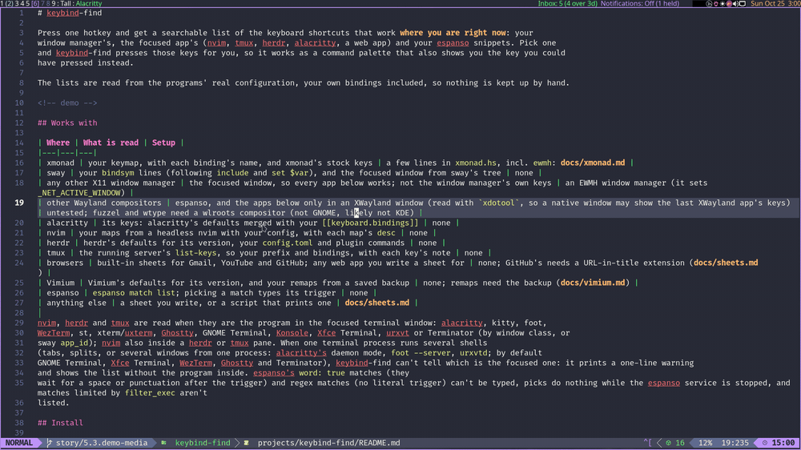

# keybind-find

Press one hotkey and get a searchable list of the keyboard shortcuts that work **where you are right now**: your
window manager's, the focused app's (nvim, tmux, herdr, alacritty, a web app) and your espanso snippets. Pick one
and keybind-find presses those keys for you, so it works as a command palette that also shows you the key you could
have pressed instead.

The lists are read from the programs' real configuration, your own bindings included, so nothing is kept up by hand.



## Works with

| Where | What is read | Setup |
|---|---|---|
| xmonad | your keymap, with each binding's name, and xmonad's stock keys | a few lines in `xmonad.hs`, incl. `ewmh`: [docs/xmonad.md](docs/xmonad.md) |
| sway | your `bindsym` lines (following `include` and `set $var`), and the focused window from sway's tree | none |
| Hyprland | its binds from the running compositor (`hyprctl -j binds`), with each bind's description, and the focused window from `hyprctl` | none ([below](#hyprland)) |
| KDE Plasma | its global shortcuts (`kglobalshortcutsrc`) and the launch shortcuts of `.desktop` files, and the focused window (on Wayland from `kdotool`) | on Wayland, `kdotool`; picks there are not sent ([below](#kde-plasma)) |
| i3 | the bindings of the config i3 has loaded (`i3-msg -t get_config`; from 4.20, includes followed and variables replaced by i3) | none ([below](#i3)) |
| Xfce | xfwm4's window shortcuts and your application shortcuts, from `xfconf-query` (X11) | `xfconf-query` ([below](#xfce)) |
| GNOME | its window, shell, mutter and media-key shortcuts, your custom shortcuts and the overlay key, from `gsettings`; on X11 also the focused window | `gsettings`; on Wayland picks are not sent and the list opens in fzf ([below](#gnome)) |
| any other X11 window manager | the focused window, so every app below works; not the window manager's own keys | an EWMH window manager (it sets `_NET_ACTIVE_WINDOW`) |
| other Wayland compositors (niri) | espanso only: the focused window isn't read, so no app below | untested |
| alacritty | its keys: alacritty's defaults merged with your `[[keyboard.bindings]]` | none |
| Ghostty | its keys from `ghostty +list-keybinds`, as your config sets them | none ([below](#ghostty)) |
| kitty | its default shortcuts for its version (0.49.2 built in) with your `kitty.conf` maps on top | none; the program in a tab needs remote control ([below](#kitty)) |
| foot | its default key, search and URL bindings for its version (1.28.0 built in) with your `foot.ini` on top, and its text bindings | none ([below](#foot)) |
| GNOME Terminal | its keyboard shortcuts as its preferences set them, from `gsettings` (not on GNOME under Wayland, where the window isn't read) | `gsettings` ([below](#gnome-terminal)) |
| nvim | your maps from a headless nvim with your config, with each map's `desc` | none |
| Emacs | the keys active in the buffer you are in, from the running Emacs over its server, with its major mode and evil state; with no server, the global map (and evil's) of your init file from `emacs --batch` | `server-start` in your init, or `emacs --daemon`, for the live read ([below](#emacs)) |
| vim | your maps (`:map`, `:map!`, `:tmap`, `:lmap`) from a headless vim with your vimrc; not vim's built-in keys | none; it runs your vimrc ([below](#vim)) |
| nano | its main-menu keys: nano's defaults for its version (7.2, 8.4 and 9.2 built in) with your nanorc's `bind`/`unbind` on top | none ([below](#nano)) |
| micro | its keys: micro's defaults for its version (2.0.11, 2.0.14 and 2.0.15 built in) with your `bindings.json` on top | none ([below](#micro)) |
| Midnight Commander | its keys by section (file manager, panel, editor, viewer, …): mc's compiled-in defaults (4.8.33's built in) with the system and your keymap on top | none ([below](#midnight-commander)) |
| yazi | its keys: yazi's default keymap for its version (25.4.8, 25.5.31 and 26.9.1 built in) with your `keymap.toml` merged in | none ([below](#yazi)) |
| herdr | herdr's defaults for its version, your `config.toml` and plugin commands | none |
| tmux | the running server's `list-keys`, so your prefix and bindings, with each key's note | none |
| GNU screen | its default command keys for its version (4.9 and 5.0 built in) with `/etc/screenrc` and your screenrc's `bind`, `bind -c` and `escape` on top | none ([below](#screen)) |
| bash, zsh, fish | the prompt's line-editing keys from the shell itself: bash's `bind -p`/`-s`/`-X` (with your `.inputrc`), zsh's `bindkey -L`, fish's `bind` (every mode) | none; it runs your rc files: [below](#shells-run-your-rc-files) |
| less | its keys from `less --help`, with your lesskey file's `#command` binds on top; also under `man`, `git log`, `systemctl status` | none; your keys need less 582+ and the lesskey source file ([below](#less)) |
| mpv | the bindings of a headless mpv started with your config: built-ins, your `input.conf` and keys your scripts bind at load, with each one's comment | none; it starts mpv on every `Super+/` ([below](#mpv)) |
| zathura | its keys: zathura's defaults for its version (0.5.2, 0.5.11 and 2026.10.23 built in) with your zathurarc's `map`/`unmap` on top | none ([below](#zathura)) |
| VS Code, VSCodium, Code - OSS | the default keys (1.143.1's built in), your installed extensions' and your `keybindings.json` on top, each tagged with where it works; the file's language guessed from the title | none ([below](#vs-code)) |
| Zed | its default keymaps (1.25.3's built in) for your base keymap and vim or helix mode, with your `keymap.json` on top, each tagged with its context; the file's extension guessed from the title | none ([below](#zed)) |
| Obsidian | its default hotkeys (1.14.5's built in) with your vault's `.obsidian/hotkeys.json` on top, the vault picked by window title | none ([below](#obsidian)) |
| st, surf, tabbed, dwm | their stock keys from `config.def.h` at st 0.9.3, surf 2.1, tabbed 0.9 and dwm 6.8 (dwm's in a dwm session, whatever window has focus); a patched `config.h` isn't read: replace the sheet with your own of the same name | none ([below](#suckless-st-surf-tabbed-dwm)) |
| browsers | built-in sheets for Gmail, YouTube and GitHub; any web app you write a sheet for | none; GitHub's needs a URL-in-title extension ([docs/sheets.md](docs/sheets.md)) |
| Firefox / Chromium keys | the browser's own shortcuts (tabs, navigation, find, dev tools) in Firefox, LibreWolf, Zen, Chromium, Chrome, Brave and Edge, from built-in sheets | none ([below](#firefox-and-chromium)) |
| Vimium | Vimium's defaults for its version, and your remaps from a saved backup | none; remaps need the backup ([docs/vimium.md](docs/vimium.md)) |
| espanso | `espanso match list`; picking a match types its trigger | none |
| anything else | a sheet you write, or a script that prints one | [docs/sheets.md](docs/sheets.md) |

nvim, vim, Emacs (and `emacsclient -t`), nano, micro, mc (and mcedit, mcview, mcdiff), yazi, herdr, tmux, screen, the shells and less are read when they are the program in the focused terminal window: alacritty, kitty, foot,
WezTerm, st, xterm/uxterm, Ghostty, GNOME Terminal, Konsole, Xfce Terminal, urxvt or Terminator (by window class, or
sway `app_id`, Hyprland `class`); nvim also inside a herdr or tmux pane or a screen window. When one terminal process runs several shells
(tabs, splits, or several windows from one process: alacritty's daemon mode, `foot --server`, `urxvtd`; by default
GNOME Terminal, Xfce Terminal, WezTerm, Ghostty and Terminator), keybind-find can't tell which is the focused one: it prints a one-line warning
and shows the list without the program inside (the terminal's own keys, alacritty's, Ghostty's, kitty's, foot's or GNOME Terminal's, are still listed).
kitty can say which tab has focus when its remote control is on ([below](#kitty)). espanso's `word: true` matches (they
wait for a space or punctuation after the trigger) and regex matches (no literal trigger) can't be typed, picks do nothing while the espanso service is stopped, and matches limited by `filter_exec` aren't
listed.

### Shells run your rc files

Over a shell prompt, keybind-find starts your shell as `bash -ic`, `zsh -ic` or `fish -ic` on every `Super+/`, so
**your rc files run each time** (`.bashrc`, `.zshrc`, `config.fish`): whatever they start, they start again. The
shell gets 3 seconds; an rc file that takes longer, or `exec`s another program (`exec tmux`), is killed and the shell
is left out with a one-line warning. keybind-find sets `KEYBIND_FIND=1` for it, so you can skip slow or noisy parts:

```sh
[ -n "$KEYBIND_FIND" ] && return   # bash or zsh: put it after your binds, before the slow part
# fish: wrap the slow part in  if not set -q KEYBIND_FIND; ...; end
```

For fish it also sends the `fish_prompt` event (fish loads its bindings on the first prompt), so your prompt's event
handlers run too.

What it can't see: binds you made by hand in the running shell, binds a plugin adds later (zsh plugins that bind in
a hook or on first use), and an `INPUTRC` or `bind` set only in a login profile. For bash and zsh it shows the keymap
in force when the rc files are done: in vi mode that is insert mode (`viins`, bash's `vi-insert`), not command mode.
The shell it starts is the one on keybind-find's `PATH` (your window manager's), which may not be the one in the
terminal if you installed another. A script running in the terminal (`bash build.sh`) looks like a shell, so the
prompt's keys show then too.

### less

less is shown whenever it is any program in the terminal's foreground job, so it shows under `man`, `git log` and
`systemctl status` too, as well as the program that started it when keybind-find reads that one (a shell running a
script that pipes into less). Your keys are read from the lesskey **source** file less reads: `$LESSKEYIN`, else
`$XDG_CONFIG_HOME/lesskey`, `~/.config/lesskey` or `~/.lesskey`. Only its `#command` section is used; `#version`
lines are ignored. Before less 582, `lesskey` compiled your keys into a binary `~/.less`; a compiled file (`~/.less` or
`$LESSKEY`) is never read, on any version: you get less's defaults and a one-line note. Debian's `man` runs less
as `pager`, which is recognised too. `LESSKEYIN` and `XDG_CONFIG_HOME` come from keybind-find's environment (your
window manager's), not the shell's, so a value set only in an rc file isn't seen.

### mpv

mpv is shown when its window is focused (window class `mpv`, or the Flatpak's `io.mpv.Mpv`), not when mpv plays
inside a terminal. On every `Super+/` keybind-find starts mpv headless (`--vo=null --ao=null --idle=once`: no window,
no sound, no file) with your config, so **your scripts load each time**, as at any mpv start, and a heavy config makes
the list slower; mpv gets 3 seconds. It never takes over your player's `input-ipc-server` socket or `log-file`. The
bindings are those of an idle mpv: keys a script binds later, while a file plays (uosc and similar), exist only in the
running player and aren't listed. Mouse and wheel bindings and keys bound to `ignore` are left out. A Flatpak-only
mpv isn't run (keybind-find needs `mpv` on `PATH`), but when mpv finds no config directory of its own
(`$XDG_CONFIG_HOME/mpv` or `~/.config/mpv`, or `~/.mpv`), the Flatpak's (`~/.var/app/io.mpv.Mpv/config/mpv`) is
used.

### zathura

In a zathura window, keybind-find lists zathura's keys by mode (`normal`, `index`, `presentation`, `fullscreen`,
`insert`): the defaults of your zathura's version (from `zathura --version`; 0.5.2, 0.5.11 and 2026.10.23 are built in,
generated from zathura's and girara's source at each tag; another version uses the nearest of the same major version,
else the nearest older, and says so), with the `map` and `unmap` lines of the zathurarc files zathura reads laid over
them, in its order: `zathurarc` in each `$XDG_CONFIG_DIRS` directory (else `/etc/xdg`) from the last, `/etc/zathurarc`,
then your `~/.config/zathura/zathurarc` (or under `$XDG_CONFIG_HOME`; the Flatpak's under
`~/.var/app/org.pwmt.zathura`), following `include` (each file is read once, where zathura reads a file again each time
it is included). As in zathura, a `map` with a function or mode zathura doesn't know changes nothing, and a line with an
unclosed quote ends its file there (counted in one line). A fullscreen key that does the same as in normal mode is
listed once, under `normal`. Each key shows its function and argument as a zathurarc line says them (`scroll down`,
`focus_inputbar :open`; a default's argument with no zathurarc name in brackets: `zoom (original)`). Not listed: mouse
binds (yours are counted in one line, as are keys girara refuses, such as two modifiers in `<C-S-x>`). Not read: a
config dir given with `zathura -c`/`--config-dir`, and for the Flatpak, its runtime's `/etc` (the host's is read).

### VS Code

In a VS Code window (Visual Studio Code, Insiders, VSCodium or Code - OSS, recognised by its window class; the title's
product name says which), keybind-find lists VS Code's default keybindings for Linux, pinned for 1.143.1 (one version,
not checked against yours, since that would mean running VS Code's CLI on every press), then the keybindings your
installed extensions contribute, then your `keybindings.json` (`~/.config/<Code|Code - Insiders|VSCodium|Code - OSS>/User/`,
or under `$XDG_CONFIG_HOME`, or the Flatpak's). As in VS Code, a `-command` rule (yours, or one an extension
contributes) removes that command's default and extension binds (those whose key is its key or starts with it, and whose `when` is its `when` as written, any when it
gives none or `true`; never your own), wherever it stands in the file. A rule
with the same key and `when` as an earlier one is listed in its place (VS Code would also let it shadow binds whose
`when` it covers; those stay listed). Each bind's `when` clause becomes scopes: `editorTextFocus` shows as
`[editorTextFocus=true]`, `!editorReadonly` as `[editorReadonly=false]`, `editorLangId == rust` as `[filetype=rust]` (`resourceLangId` and `resourceExtname` follow whichever view has focus, the editor's file or the explorer's selection, so they stay tags);
parts that can't be a scope (`!=`, regexes, `in`, comparisons) are dropped, so a bind is shown in more places, never
fewer, and binds VS Code never runs on Linux (a `when` of `false`, or one that needs `isMac`, `isWindows` or `isWeb`)
aren't listed. A key you bind to no command does nothing, so the default it replaces isn't listed either. With the keybind-find extension (below) the file's language and
extension come from VS Code itself; without it they are guessed from the window title, which needs VS Code's default `window.title` (the file first, the product name
last); with no editor open the folder name is taken for a file name. Only the default profile's `keybindings.json` is
read. Extensions come from `~/.vscode/extensions` (Insiders `~/.vscode-insiders`, VSCodium and Code - OSS
`~/.vscode-oss`, or the Flatpak's), those its `extensions.json` lists; disabled ones are still listed (VS Code keeps
that in a database). Keys keybind-find can't name (`[IntlBackslash]`, the browser keys), `when` clauses it can't read
and extensions whose `package.json` doesn't parse are counted in one line.

**The keybind-find extension** (`editors/vscode/`, two files, no build step) tells keybind-find the language
(`editorLangId`, as `filetype`) and the extension of the file open in the focused window, exactly, with any
`window.title`. To install it, copy the folder from this repository and restart VS Code:

```sh
rm -rf ~/.vscode/extensions/keybind-find.keybind-find-0.1.0
cp -r editors/vscode ~/.vscode/extensions/keybind-find.keybind-find-0.1.0
```

(`~/.vscode-insiders/extensions/` for Insiders, `~/.vscode-oss/extensions/` for VSCodium and Code - OSS.) It writes
one small file per window, `$XDG_RUNTIME_DIR/keybind-find/vscode/<pid>.json`, when the window's focus, editor or
language changes, and deletes it when the window closes; it makes no network calls and runs nothing. The language is
the active text editor's (the Output panel is one), and stays the last one while the terminal has focus. Snap and Flatpak builds keep their runtime
directory to themselves, so there keybind-find falls back to the window title. It can't report the
rest of VS Code's context: no extension can read context keys, so focus keys (`editorTextFocus`, `terminalFocus`),
the `resource*` keys and other extensions' keys (VSCodeVim's mode) stay tags. It isn't on the Marketplace or Open VSX
yet.

### Zed

Over a Zed window (app id or X11 class `dev.zed.Zed`, or its `-Preview`, `-Nightly` and `-Dev` channels), keybind-find
lists Zed's keys without running Zed: the Linux keymaps of Zed 1.25.3 built in
([data/zed/1.25.3/](data/zed/1.25.3), GPL-3.0-or-later, as Zed's assets), loaded as Zed loads them. That is the
default keymap, then your `base_keymap`'s (VS Code, JetBrains, Sublime Text, Atom, Emacs or Cursor; `Zed` and
`TextMate` add none, `None` loads no defaults at all), then Zed's vim keymap when `vim_mode` or `helix_mode` is on,
then Zed's specific overrides, then your `keymap.json` on top. A bind of yours replaces the one before it with the same key and the same context, and
`null` removes it; an `unbind` (or `zed::Unbind`) removes the binds of that key to that action, in its context (in
any, with none). A binding whose action isn't Zed's shape is left out with a line, as Zed does. Both files are read from `~/.config/zed/` (`$XDG_CONFIG_HOME/zed/`), or the Flatpak's
`~/.var/app/dev.zed.Zed/config/zed/` when the first doesn't exist; a file that doesn't parse is one line and is left
out. Only one Zed version is built in, and Zed updates itself weekly: keys a newer Zed added or moved are missing
until keybind-find's copy is updated. AI bindings that `disable_ai` would hide are listed.

Each bind's `context` is shown as tags: `Editor` as `[Editor=true]`, `!menu` as `[menu=false]`, `extension == md` as
`[extension=md]`, vim's `vim_mode == normal` as `[mode=normal]` and Zed's own `mode == full` as `[editor_mode=full]`;
for `A > B` only `B`'s; an `||` keeps what both sides share, and `!=` or a negated group none. So a tag says where a
bind works, never more narrowly than Zed. The facts are `os=linux` (so `os == windows` binds are hidden) and the
file's `extension`, taken from the window title in
Zed's default format (`project — main.rs`), which hides the keys of other file types (`extension == md`). The guess
needs the default `window_title_format`: one without ` — ` gives no fact, and one that doesn't end in the file name
gives a wrong one. Keys Zed binds that keybind-find can't send (`fn-`, a lone `shift`,
`shift-` with a non-letter, media keys such as `copy`) are left out with a count.

### Obsidian

In an Obsidian window (class or app id `obsidian`, or `md.obsidian.Obsidian`, Obsidian's desktop name and the
Flatpak's id), keybind-find lists Obsidian's command hotkeys: the defaults of Obsidian 1.14.5 (read from that
release's app bundle; Obsidian isn't run, so its version isn't checked and every version gets these), with the
focused vault's `.obsidian/hotkeys.json` on top, as Obsidian uses it: a command you gave hotkeys has only yours, and
one you cleared has none. Your vaults are listed in `obsidian.json`, the first found of `$XDG_CONFIG_HOME/obsidian`
(else `~/.config/obsidian`, as for the AppImage), the Flatpak's `~/.var/app/md.obsidian.Obsidian/config/obsidian` and
the Snap's `~/snap/obsidian/current/.config/obsidian`; the first found is used, even when it is an older install's.
The window title (`<note> - <vault> - Obsidian <version>`) names the vault; with one vault it is that one, and with
several and a title that names none (a pop-out window), or two vaults sharing that folder name, you get the defaults
and a one-line note. A plugin's hotkey is listed under the plugin's id; it, and a command with no default hotkey that
you gave one, are described by their command id. Only the `.obsidian` config folder is read (a vault set to another
config folder keeps that inside Obsidian), and only command hotkeys are listed: keys that aren't commands, such as
the editor's own (CodeMirror's), aren't.

### Firefox and Chromium

A Firefox window (also Firefox Developer Edition, LibreWolf and Zen, and their Snap and Flatpak builds) lists
Firefox's own shortcuts; a Chromium, Google Chrome, Brave or Edge window lists Chromium's. Vivaldi and Opera have
keymaps of their own and get neither. The keys are those of the version named in the sheet's title
([data/sheets/firefox.json](data/sheets/firefox.json), [chromium.json](data/sheets/chromium.json)), as the browser's
support page lists them for Linux; another version may differ. They are left
out on a tab where a web-app sheet applies (Gmail, YouTube, GitHub or a `.json` sheet of yours with a `window_title`;
their loose title matches, such as `github.com` on `docs.github.com`, count too), and in an installed Chromium,
Brave or Edge app (PWA) window, on Wayland (by its class) and X11 alike (on X11 by its `WM_CLASS` instance,
`crx_<app id>`). A `--app=URL` window isn't told apart anywhere and still gets them, as does an app window in
XWayland under Hyprland (`hyprctl` doesn't report the instance). Brave and Edge get Chromium's keys, LibreWolf and
Zen Firefox's, which they share; their own extra keys (Zen's workspaces, say) aren't listed. To replace
one, put a `firefox.json` or `chromium.json` in your sheets folder ([docs/sheets.md](docs/sheets.md)): it turns the
built-in sheet off for the whole family, but applies only by its own `provider`, as any sheet does (`firefox` is
Firefox's window class only; LibreWolf or Zen need a sheet with their class).

### suckless (st, surf, tabbed, dwm)

These programs are configured by editing `config.h` and recompiling, so keybind-find can't read your keys: it ships
the stock ones, from each release's `config.def.h`
([data/sheets/st.json](data/sheets/st.json), [surf.json](data/sheets/surf.json),
[tabbed.json](data/sheets/tabbed.json), [dwm.json](data/sheets/dwm.json)). st's apply in a window of class
`st-256color` or `St` (or that instance, as with `st -c scratchpad`), surf's in `Surf`, tabbed's in `tabbed`; a surf or st embedded in tabbed is part of tabbed's
window, so only tabbed's keys show there. dwm's apply in a dwm session (by its `_NET_WM_NAME`, or the `dwm` process when `wmname` changed that), beside the focused
window's, and only when a window has focus: on an empty desktop nothing is listed. If you patched `config.h`, copy the built-in sheet into
your sheets folder under the same name (`st.json`, `dwm.json`, …) and edit it ([docs/sheets.md](docs/sheets.md)): it
replaces the built-in one and applies where it did, whatever its `provider`. For st, surf and tabbed a parser named
after the window class (`st-256color`, by class only) that reads your `config.h` works too; it adds to the built-in sheet, so
replace that with an empty one.

There is no dmenu sheet: dmenu grabs the keyboard and is never the focused window, so `Super+/` can't open over it
and a picked key couldn't reach it.

### Emacs

Over Emacs in a terminal (`emacs`, `emacs-nox`, `emacs-gtk`, `emacs-lucid`, `emacs-pgtk`, or `emacsclient -t`), or an
Emacs window (class or Wayland app id `emacs`), keybind-find asks the running Emacs over its server socket
(`emacsclient --eval`, 2 seconds) for the keys active in the selected window's buffer: every keymap Emacs would look a
key up in, in its order (minor modes, the major mode's map, the global map), each key once, as the one that runs.
Global keys carry no tag; the major mode's carry `major-mode=<mode>`, and those of minor modes and other maps
`buffer=current`. The buffer's major mode (`major-mode`) and, with evil on in it, its state (`mode`: `normal`,
`insert`, `visual`, …) are facts, so the keys of another major mode or evil state are hidden. The socket is found from
the command line (`--daemon=NAME`, `--fg-daemon=NAME`, emacsclient's `-s NAME`) or among the sockets in Emacs's server
directory (`$XDG_RUNTIME_DIR/emacs`, else `/tmp/emacs<uid>`; for `emacsclient` without `-s`, its default `server`
first); an Emacs with no server (no `(server-start)` in your init) is read as below without a note, and a socket that
doesn't answer (also a stale one left by an Emacs that crashed) is one line. A remapped command (`[remap …]`, as
counsel or consult set up) is listed as the command that runs. A TCP server (`server-use-tcp`) isn't asked.
`ALTERNATE_EDITOR` is removed for this, so no daemon is ever started.

With no server to ask (or `keybind-find dump emacs` from a shell), keybind-find runs `emacs --batch` with your init
(`early-init.el`, your installed packages, then `~/.emacs`, `~/.emacs.el` or `init.el` in `~/.emacs.d` or
`~/.config/emacs`) on every `Super+/`, and lists the global map and, when your init loads evil, evil's normal, insert,
visual and motion state maps (tagged `mode=<state>`); buffer and mode keys need the running Emacs. Your init runs as at
any start (packages it installs, too) but with `server-start` turned off and `kill-emacs-hook` cleared, so it can't
touch a running Emacs or write recentf, savehist or desktop files; `after-init-hook` and `emacs-startup-hook` don't
run, so keys set up there (`:hook (after-init . evil-mode)`) are missing. It gets 10 seconds, and an error in it is one
line, with the keys it set up before that listed. Doom Emacs and Spacemacs need their own startup: their init isn't loaded, and only Emacs's own global map
is listed, with one line saying so. Mouse, menu and tool-bar entries, the `[remap …]` entries themselves, keyboard macros and lambdas aren't
listed, and keys keybind-find can't send (hyper or `A-` modifiers, a key with no X keysym such as `<again>`) are left
out with a count.

### vim

Over vim or vi in a terminal, or a gvim window (class `Gvim`), keybind-find starts vim headless (`vim -es`) with your
vimrc (`~/.vimrc`, `~/.vim/vimrc` or `~/.config/vim/vimrc`, the first that exists) on every `Super+/` and lists your
maps, each tagged with its modes. Your vimrc and plugins run, as at any vim start (but not `VimEnter` autocommands,
so maps made there are missing); vim gets 10 seconds. A vimrc that prints or has an error is fine: the maps are read all the same. With no vimrc you get what a
plain vim start sets (`defaults.vim`). vim's own keys aren't listed: they are vim's documentation's (`:help index`),
and your maps are what you forget. Left out: plugins' `<Plug>` and script-local maps, buffer-local maps (a headless
vim has no file of yours open), maps made by hand in the running vim, the system vimrc's (`/etc/vimrc`), `$EXINIT`
and `~/.exrc` (with no vimrc), and a gvim's `.gvimrc` and `has('gui_running')` branches. `~/.config/vim/vimrc` is
read as vim 9.1.0327 and later read it; an older vim ignores it. vim run as `vimdiff`, `view` or `rvim` isn't
recognised. `HOME`, `XDG_CONFIG_HOME` and `VIMINIT` are keybind-find's (your
window manager's environment), not the running vim's; when `VIMINIT` is set, vim reads it instead of a vimrc, and
keybind-find says so and shows nothing for vim. The `vim` on `PATH` is run (else `vi`, Debian's vim-tiny): a `vim`
that is nvim gets nvim's list, and a vim without `+eval` (vim-tiny) is a one-line note. Over a `vi` that is another
editor (ex-vi, busybox), the list is still `vim`'s.

### nano

Over nano or rnano in a terminal, keybind-find lists nano's main-menu keys: the defaults of your nano's version
(from `nano --version`; 7.2, 8.4 and 9.2 are built in, taken from nano's source at each tag; another version uses
the nearest of the same major version, else the nearest older, and says so), with the `bind` and `unbind` lines of
`/etc/nanorc` and then your nanorc (the first readable of `~/.nanorc`, `$XDG_CONFIG_HOME/nano/nanorc`,
`~/.config/nano/nanorc`) laid over them, for the `main` and `all` menus, as nano reads them: a key name or a function
nano doesn't take changes nothing, and a bind to a macro or to another menu's function takes the key away. Macros and
other menus are not listed. `include` lines are checked (a missing file is a one-line note), but nano reads only
syntax definitions from included files, so they change no key. The defaults are a normal build's with no options:
`--modernbindings`, `--rcfile` and the like aren't read, rnano is shown with nano's keys, and a nano built with
another system nanorc than `/etc/nanorc` has that file's binds missed.

### micro

Over micro in a terminal, keybind-find lists micro's keys by pane type (`buffer`, `command`, `terminal`): the Linux
defaults of your micro's version (from `micro -version`; 2.0.11, 2.0.14 and 2.0.15 are built in, generated from micro's
source at each tag; another version uses the nearest older one of the same major version (else a newer one of it), else
the nearest older, else the oldest, and says so) with your `bindings.json` on top, as micro reads it: from
`$MICRO_CONFIG_HOME`, else `$XDG_CONFIG_HOME/micro`, else `~/.config/micro`; comments and trailing commas allowed (other
JSON5, such as single quotes, isn't); a top-level `"key": "action"` binds in `buffer`, an object named after a pane
binds there, and `"None"` unbinds. Two spellings of one key replace each other as in micro (`CtrlS` and `Ctrl-s`); keys
micro tells apart stay apart, even where the terminal sends the same thing (`Ctrl-m` and `Enter`). Each key shows its
action as written (`Copy|CopyLine`, `command:pwd`). A `bindings.json` that doesn't parse is one line, and micro's
defaults are shown; mouse keys, raw escapes, keys micro or keybind-find can't read and values that aren't strings are
left out, counted in one line. Not read: keys bound by Lua plugins (unless written to `bindings.json`), and a config dir
given with `-config-dir`.

### Midnight Commander

When mc, mcedit, mcview or mcdiff is the program in the focused terminal, keybind-find lists mc's keys, one category per
keymap section (`filemanager`, `panel`, `editor`, `viewer`, `viewer:hex`, …), built as mc builds its keymap: mc 4.8.33's
compiled-in defaults, then `/usr/share/mc/mc.keymap` and the system keymap (`$MC_DATADIR/mc.keymap`, else
`/etc/mc/mc.keymap`), then **one** user keymap: `$MC_KEYMAP`, else the `keymap` value in `[Midnight-Commander]` of
`~/.config/mc/ini`, else `~/.config/mc/mc.keymap` (or under `$XDG_CONFIG_HOME/mc`). Distros install mc's full default
keymap as `/etc/mc/mc.keymap`, so another mc version's keys show for every action that file names (actions only
4.8.33 compiles in still show). A name without `.keymap` gets it, and a relative one is looked for in `~/.config/mc`,
then `/usr/share/mc`. A later file replaces an action's keys, and `Action =` removes it; a key two actions name in one
section shows on the first, as mc uses the first. Keys in a `:xmap` section follow the key that opens it
(`ExtendedKeyMap`, `ctrl+x c`): the first of its keys that no earlier action in that section has. When every one is
taken, as `WordRight` takes the editor's `ctrl-x` by default, mc never opens the map and its keys aren't listed (a key
bound in a section mc consults first, such as `[panel]` before `[filemanager]`, isn't checked). A line mc's keyfile reader can't read ends the file there, with a
one-line note; a misspelt action is listed as written; key names keybind-find can't name (including ones mc can't read,
such as the `ctr-a` in mc's own default keymap) are left out and counted in one line.

Not seen: a keymap given with `mc -K`, and `MC_KEYMAP` or `MC_DATADIR` set only in the shell that started mc
(keybind-find has its own environment, from your window manager). While mc's subshell is in front (Ctrl-O) the terminal
still reports mc, so mc's keys are listed, not the shell's. MinIO's client is also called `mc`; in a terminal running
it you get Midnight Commander's list.

### yazi

Over yazi in a terminal, keybind-find lists yazi's keys by section (`mgr`, `input`, `tasks`, …; `manager` before yazi
25.5.28): the default keymap of your yazi's version (from `yazi --version`; 25.4.8, 25.5.31 and 26.9.1 are built in,
yazi's own `keymap-default.toml` at each tag; another version uses the nearest of the same year, else the nearest older,
else the oldest, and says so: 25.5.28 to 25.5.30 get 25.4.8's, with `manager` where they have `mgr`, so there your
`[mgr]` is ignored too) with your `keymap.toml` merged in as yazi merges it. It is read from `$YAZI_CONFIG_HOME`, else
`$XDG_CONFIG_HOME/yazi`, else `~/.config/yazi`. Per section, `keymap` replaces the defaults, `prepend_keymap` goes first
and replaces the defaults on the same first two keys, and `append_keymap` goes last unless a default has those keys; an
entry for another platform (`for = "macos"`; before 26.x also `for = "all"`) or one that runs `noop` (how yazi unbinds a
key) isn't listed, and of two on the same keys only the first is, as yazi runs the first. A section your yazi doesn't
have (`[manager]` from 25.5.28 on) is named in one line and ignored, as yazi ignores it. A `keymap.toml` yazi would
refuse (not TOML, an entry without `on` or `run`, a key with a modifier yazi doesn't know, from 26.x a `for` it doesn't
know, a section that isn't a table) is one line, and yazi's defaults are shown. A key with no keysym keybind-find knows
is left out, counted in one line. Not read: keys plugins or `init.lua` change at runtime; a plugin bound in
`keymap.toml` (`run = "plugin foo"`) is listed by its `run`.

### Hyprland

Under Hyprland, keybind-find asks the running compositor for its binds (`hyprctl -j binds`) and never reads your
config (from Hyprland 0.56 it is Lua). A bind shows its `description`, or else its dispatcher and argument
(`exec kitty`); in a 0.56 Lua config without a description that is only the dispatcher's name (`exec_cmd`) or
`lua function`, so give binds a `description` to find them by what they do. Binds are grouped by dispatcher. A bind in
a submap is tagged with it (`[submap=resize]`), since keybind-find can't tell which submap is active. Mouse and wheel
binds, catch-all binds, binds by keycode (`code:NN`), long-press binds, key names that aren't keysym names, and binds
in a submap whose name has spaces or other characters a scope name can't hold can't be sent or scoped, and are left
out, counted in one line. Caps Lock and Num Lock in a bind's modifiers are ignored. The
focused window comes from `hyprctl -j activewindow`, never from X, so a native Wayland window is never mistaken for the
last XWayland one; if `hyprctl` fails, that is a line for the window and one for the binds, and the list goes
on without them.

### screen

GNU screen can't print its key table, so keybind-find takes screen's default command keys for its version (from
`process.c` `InitKeytab()` of 4.9.1 and 5.0.2; another version gets the nearest, with a one-line note) and lays
`/etc/screenrc` and then your screenrc (`$SCREENRC`, else `~/.screenrc`, as keybind-find's own environment has them)
over them, following `source`: `bind` adds, replaces or removes a key, `escape`/`defescape` moves every key behind your
command key, and `bind -c <class>` keys are listed behind the key that enters the class (`bind r command -c resize`).
Not read: `-e` or `-c` on screen's command line, a system screenrc built in somewhere other than `/etc/screenrc`,
`$SYSSCREENRC`, `bindkey` and `bind -k` lines (counted in the one-line note), and per-user `escape` in multiuser
sessions. nvim inside screen is found through the one attached session (`screen -ls`) and its current window; with
several attached sessions keybind-find can't tell which is yours, says so in one line, and shows screen's keys without
nvim's. A session shared by several terminals (`screen -x`) answers for one of them, which may not be the focused one.
A window renumbered with `number` may not be found. Other programs inside screen aren't looked for.

### Ghostty

In a Ghostty window, keybind-find asks `ghostty +list-keybinds --plain`, which reads your config files (and their
`config-file` includes) as Ghostty does, so the list is what the config on disk says: a change you haven't reloaded
yet is already shown. Without a config file it asks for the defaults (`--default`), since a plain `+list-keybinds`
would write a template config for you. Binds are grouped by action. A bind in a key table (Ghostty 1.3+,
`resize/h=…`) is tagged with it (`[key_table=resize]`), since keybind-find can't tell which table is active.
Binds with `global:`, `all:`, `unconsumed:` or `performable:` are listed without that prefix: `+list-keybinds`
doesn't print it. `catch_all`, non-ASCII keys, keys with no X keysym and key tables whose name can't be a scope are
left out, counted in one line. Ghostty 1.2+ names keys by their place on a US keyboard (`key_q`, `digit_1`), and
keybind-find shows and sends that key's US symbol, so on another layout (AZERTY, Dvorak) such a bind may be on a
different key. Started from the desktop, Ghostty runs every window, tab and split in one process
(`gtk-single-instance`), and it has no command that names the focused one, so the program inside (nvim, a shell) is
found only when that process runs one shell; otherwise you get Ghostty's keys and the one-line warning above. A
window whose class you changed (Ghostty's `class` option) isn't recognised as Ghostty.

### kitty

In a kitty window, keybind-find lists kitty's default shortcuts for its version (from kitty's
`kitty/options/definition.py` at 0.49.2; another version gets the nearest, with a one-line note; with no `kitty` on
`PATH` or in `~/.local/kitty.app/bin`, the newest) with your `kitty.conf` on top, read as kitty reads it: the file in
`$KITTY_CONFIG_DIRECTORY`, else the first `kitty/kitty.conf` under `$XDG_CONFIG_HOME`, `~/.config`, then each
`$XDG_CONFIG_DIRS` entry (a config directory you can't write to, which kitty skips, is still read), following
`include` and `globinclude`. Either way the system file `/etc/xdg/kitty/kitty.conf`, when there is one, is read first
and yours on top. Your `map` lines replace or remove (`map <key>` with no action, or
`no_op`) the default on the same key, `kitty_mod` applies to every map that uses it, and `clear_all_shortcuts yes` drops
every map before it. A key in a keyboard mode (`map --mode resize …`) is tagged with it (`[keyboard_mode=resize]`), and
the key that enters the mode (`--new-mode`) is listed too. A default keeps kitty's title (`Copy to clipboard`); your
own map shows its action. Not read: `envinclude` and `geninclude` (it runs a program), noted in one line; left out and
counted in one line: `--when-focus-on` maps (they depend on the window, which keybind-find can't see), `hyper`,
`caps_lock` and `num_lock` modifiers, keys with no X keysym, and a mode name that can't be a scope.

kitty runs every OS window, tab and split from one process, so with more than one shell open keybind-find has to ask
kitty which one is focused before it can list the program inside (nvim, a shell). It asks only when kitty's remote
control is reachable from outside: put these in `kitty.conf` and restart kitty:

```
allow_remote_control socket-only
listen_on unix:@kitty
```

keybind-find then finds the address in a shell's environment (`KITTY_LISTEN_ON`) and runs `kitten @ ls` (1 s limit).
keybind-find never sends a password (so kitty never asks you to allow it), so with `allow_remote_control password`
it gets no answer. Without an answer you get kitty's keys and the one-line warning above, ending with the two lines to
add. Anything that can reach that socket can control kitty, as
kitty's own documentation warns.

### foot

In a foot window (app_id `foot`, or `footclient` in server mode), keybind-find lists foot's default bindings for its
version (from foot's `config.c` at 1.28.0, each described from foot.ini(5); another version gets
the nearest, with a one-line note; with no `foot` on `PATH`, the newest) with your `foot.ini` on top, read as foot
reads it: the first of `$XDG_CONFIG_HOME/foot/foot.ini` (else `~/.config/foot/foot.ini`) and each `$XDG_CONFIG_DIRS`
entry's `foot/foot.ini` (else `/etc/xdg/foot/foot.ini`), following `include=` (absolute or `~/`). `[key-bindings]`
are listed under `foot`, `[search-bindings]` under `search`, `[url-bindings]` under `url`, and `[text-bindings]` under
`text` as the text they send (`send \x1b[A`); `[mouse-bindings]` aren't read. A line of yours replaces every default
key of that action, and `action=none` removes it; a `pipe-*` command or `regex-*` name is shown with the action. A key
you give to an action while another still has it stays with the other, as in foot, which reports it as an error;
keybind-find says so in one line too. Left out and counted in one line: a modifier other than `Control`, `Shift`,
`Mod1`/`Alt` and `Mod4`/`Super`, a key name that isn't shaped like an X keysym (names aren't looked up), an upper-case
key with `Shift` (foot never fires it), and a line foot would refuse. An include cycle, or includes nested deeper than 8, stops with a note, as does a section name foot
doesn't know. Not seen: a config given with `foot -c` (or to `foot --server`), `-o` overrides, and a foot started
with another `--app-id` or `app-id=`, which isn't recognised as foot.

foot is Wayland-only, so its window is read under sway and Hyprland. A standalone foot runs one shell per window and
the program inside is found as in any terminal; `foot --server` serves every `footclient` window from one process, and
foot can't say which shell belongs to which window, so there you get the one-line warning and foot's own keys without
the program inside.

### gnome-terminal

In a GNOME Terminal window (class `Gnome-terminal` on X11, app id `org.gnome.Terminal` under sway and Hyprland),
keybind-find lists its keyboard shortcuts, read with `gsettings list-recursively org.gnome.Terminal.Legacy.Settings`:
your changes from Preferences → Shortcuts over the installed defaults. Shortcuts set to disabled aren't listed, and
when shortcuts are turned off altogether the list has none of them and a one-line note says so. Not listed: the
terminal widget's own keys (such as `shift+Page_Up` scrolling), and F10 for the menu (an on/off setting, not a key). On GNOME under
Wayland the focused window can't be read, so GNOME Terminal's keys aren't shown there. One `gnome-terminal-server` runs
every window and tab and can't say which is focused, so with more than one tab or window open you get the one-line
warning and GNOME Terminal's own keys, without the program inside; with a single tab the program inside is found as
in any terminal.

### KDE Plasma

On Plasma, keybind-find reads the shortcuts kglobalacceld saves in `~/.config/kglobalshortcutsrc` (or under
`$XDG_CONFIG_HOME`), grouped by component (KWin, Plasma, Session Management, …), each shown by its friendly name.
Only shortcuts you have saved there are listed: a component that never wrote its shortcuts to the file isn't, since
the running kglobalaccel (over D-Bus) is not asked. Apps' launch shortcuts (`X-KDE-Shortcuts` in their `.desktop`
files under `kglobalaccel/` and `applications/`) are listed under `launch`, with your changes from the file on top.
Keys keybind-find can't send (keypad keys, a key Qt names but no X keysym matches, non-ASCII keys) are left out,
counted in one line. A modifier pressed alone (Plasma's launcher on `Meta`) is listed as `Super_L`.

On X11 the focused window is read with `xdotool` as on any X11 window manager. On Wayland it comes from
[`kdotool`](https://github.com/jinliu/kdotool) (Plasma 6; not in Arch's or Debian's repositories: AUR or
`cargo install kdotool`); without it, that is one line and the list has only Plasma's shortcuts and espanso.

On Wayland a pick is not sent: KWin doesn't offer the virtual-keyboard protocol that `wtype` needs, so keybind-find
stops with an error naming the keys to press (`press super+e yourself`) instead. `--print` prints as anywhere else.
The list shows with fuzzel, which works on KWin.

### i3

Under i3, keybind-find asks the running i3 for the config it loaded (`i3-msg -t get_config`) and reads its
`bindsym` lines as sway's are read: top-level binds under `i3`, a mode's under the mode's name. The files on disk are
not read: i3 4.20 and newer reply with every file it included and its variables already replaced, so
`set_from_resource` values are right too; before 4.20 there is no `include`, keybind-find replaces the variables
itself (matching their case exactly, where i3 ignores case), and `set_from_resource` variables stay as written. `bindcode` lines (keycodes, with no key name to show or send) are left out, counted in one line. A key
bound twice, which i3 reports as an error, shows its last binding, while i3 runs the first. Without `i3-msg`, or with
no i3 answering, that is one line and the list goes on without i3's keys.

### Xfce

On Xfce (X11), keybind-find lists the keyboard shortcuts from `xfconf-query -c xfce4-keyboard-shortcuts -l -v`:
xfwm4's window shortcuts under `window manager` (`<Alt>F4` → `close window`) and your application shortcuts under
`commands`, each shown by its command, which is never run. As Xfce does, each of the two uses your customized set
once you have changed it (`custom/override` is true), else Xfce's defaults. xfwm4's actions that work only while
moving a window or cycling windows (`cancel_key` and the arrow actions, on `Escape` and the arrows by default) are left
out. A shortcut keybind-find can't send (a modifier other than ctrl, shift, alt and super, such as `<Meta>`, `<Hyper>`
or `<Release>`; a keycode; or a key not shaped like an X keysym name, since names aren't looked up) is left out,
counted in one line. When `xfconf-query` is missing or fails (no D-Bus session to ask), that is one line and the list
goes on without Xfce's keys. Xfce's Wayland session runs another compositor, so there no Xfce shortcuts are listed.

### GNOME

On GNOME (X11 and Wayland, Ubuntu's session too), keybind-find lists the shortcuts from `gsettings list-recursively`
of five schemas: `org.gnome.desktop.wm.keybindings` under `window manager`, `org.gnome.shell.keybindings` under
`shell`, mutter's two under `mutter`, and the settings daemon's media keys under `media keys`. Each shortcut is
described by its key's name (`switch-to-workspace-left` → `switch to workspace left`); a key can have several. Your
custom shortcuts (Settings → Keyboard → Custom Shortcuts) are under `custom`, each by its name (else its command,
which is never run), and the overlay key (`Super`, shown as `Super_L`) under `shell`. The media keys' fixed hardware
keys (`*-static`) aren't listed. A schema that isn't installed is named in one line and the others are still listed;
mutter's `Above_Tab` (the key above Tab, whatever it is on your layout) and a shortcut keybind-find can't send (as for
[Xfce](#xfce)) are left out, counted in that line. Without `gsettings`, that is one line and the list goes on
without GNOME's keys.

On X11 the focused window is read as on any X11 window manager. On Wayland GNOME offers no way to read it (without
an extension), so the list has GNOME's shortcuts and espanso. A pick there is not sent: Mutter doesn't offer the
virtual-keyboard protocol that `wtype` needs, so keybind-find stops with an error naming the keys to press, as on
[KDE](#kde-plasma); `--print` prints as anywhere else. The list opens in fzf in alacritty, an ordinary window
(fuzzel needs layer-shell, which Mutter lacks), with key search off as on any Wayland; without fzf or alacritty it
falls back to fuzzel, with one line saying to install them or set `[picker]` ([docs/picker.md](docs/picker.md)).

## Install

From source, now:

```sh
cargo install --path .
```

This puts `keybind-find` in `~/.cargo/bin`. Your window manager starts it, so that directory must be on the `PATH`
the window manager was started with, not only your shell's. If it isn't, use the full path in the binding below.

Other channels; those still planned are marked:

- a static binary and a `.deb` on the [GitHub release page](https://github.com/Benjmhart/keybind-find/releases)
  (pre-releases for now)
- crates.io: `cargo install keybind-find` *(from 1.0.0)*
- Arch (AUR): `keybind-find`, or `keybind-find-bin` for the prebuilt binary *(from 1.0.0)*
- Nix: `nix run github:Benjmhart/keybind-find` *(from 1.0.0)*
- Gentoo: the GURU overlay *(from 1.0.0)*

## Bind it to `Super+/`

`Super+/` is free in stock xmonad (its help key is `Super+Shift+/`) and in sway, and it is easy to remember as "help".

- **xmonad:** follow [docs/xmonad.md](docs/xmonad.md). There, `Super+/` writes xmonad's keymap for keybind-find to
  read and then starts it.
- **sway:** `bindsym $mod+slash exec keybind-find` (with `$mod` set to `Mod4`).
- **i3:** `bindsym Mod4+slash exec keybind-find` (or `bindsym $mod+slash exec keybind-find` with `$mod` set to
  `Mod4`); i3's default config doesn't bind `Super+/`.
- **Anything else:** bind `Super+/` to run `keybind-find`.

Prefer another key? Change only that one binding; keybind-find doesn't care which key started it.

Under xmonad, float the picker window: `className =? "keybind-find" --> doCenterFloat` in your `manageHook`
(`doCenterFloat` is from `XMonad.Hooks.ManageHelpers`).

## Using it

On X11 the list opens in fzf, in **key search**: press a binding's keys (Super combinations included) and the list narrows to the
bindings that start with them; Enter runs the highlighted one. **Escape** switches to typing to filter, `ctrl-k`
goes back to pressing keys, and `ctrl-s` picks which column you search. Typing letters straight away presses keys; press Escape first
to filter by text. On Wayland the list opens in fuzzel (on GNOME, in fzf with key search off): type to filter. The
bindings you pick most come first.

- [docs/picker.md](docs/picker.md): the picker, key search, and other pickers (`[picker]` in the config: rofi,
  kitty instead of alacritty, dmenu, fuzzel, or a JSON frontend of your own)
- [docs/config.md](docs/config.md): moving keybind-find's own keys in `config.toml`
- [docs/sheets.md](docs/sheets.md): your own sheets, web apps, the built-in sheets and the sheet format
- [docs/vimium.md](docs/vimium.md): Vimium's keys and your remaps
- [docs/ranking.md](docs/ranking.md): most-used first, and the usage log
- [docs/plugins.md](docs/plugins.md): add a program: write a plugin (templates in Rust, Python, Lua and JS)

Other commands:

```sh
keybind-find --print         # the same flow, but print the commands instead of sending keys
keybind-find dump            # every sheet for the focused window, as a JSON array
keybind-find dump nvim       # one provider's sheet (xmonad, sway, espanso, nvim, herdr, tmux, ...)
keybind-find keys            # grab the keyboard, print each key you press in binding notation; Escape stops (X11)
```

## Requirements

<!-- Packages checked 2026-10-25 on archlinux.org/packages and Debian's archive (api.ftp-master.debian.org madison):
     Debian stable is trixie. -->

| Tool | Needed for | Arch | Debian |
|---|---|---|---|
| `xdotool` | X11: the focused window and sending keys | `xdotool` | `xdotool` |
| `xprop` | as `xdotool`: the window's class, title and pid | `xorg-xprop` | `x11-utils` |
| `fzf` 0.60+ (0.66+ for key search) | the list on X11 | `fzf` | `fzf` (stable has 0.60: no key search) |
| `alacritty` | the window fzf runs in | `alacritty` | `alacritty` |
| `ghostty` | Ghostty: its keys (only when a Ghostty window has focus) | `ghostty` | not in Debian's repositories: a third-party build |
| `foot` | foot: its version (else the newest defaults) | `foot` | `foot` |
| `kitty`, `kitten` | kitty: its version (else the newest defaults), and the program in its focused tab | `kitty` | `kitty` (stable has 0.41: the 0.49.2 defaults, with a note) |
| `xmodmap` | key search, and checking your `config.toml` keys | `xorg-xmodmap` | `x11-xserver-utils` |
| `dmenu` | the list on X11 without fzf or alacritty (or with fzf older than 0.60, via `KEYBIND_FIND_PICKER`) | `dmenu` | `suckless-tools` |
| `fuzzel` | the list on Wayland | `fuzzel` | `fuzzel` |
| `wtype` | Wayland: sending keys | `wtype` | `wtype` |
| `i3-msg` | i3: its config | `i3-wm` | `i3-wm` |
| `swaymsg` | sway: the focused window | `sway` | `sway` |
| `hyprctl` | Hyprland: its binds and the focused window | `hyprland` | `hyprland` |
| `xfconf-query` | Xfce: its keyboard shortcuts | `xfconf` | `xfconf` |
| `gsettings` | GNOME and GNOME Terminal: their shortcuts | `glib2` | `libglib2.0-bin` |
| `kdotool` | KDE Plasma 6 on Wayland: the focused window | AUR `kdotool`, or `cargo install kdotool` | not packaged: `cargo install kdotool` |
| `notify-send` | errors shown when run from a hotkey | `libnotify` | `libnotify-bin` |

Each app's provider needs that app (`nvim`, `herdr`, `tmux`, `espanso`), and is only asked when it applies.

## Troubleshooting

- **Nothing happens on the hotkey.** The window manager can't find `keybind-find`: put the full path
  (`~/.cargo/bin/keybind-find`) in the binding, or add `~/.cargo/bin` to the `PATH` your session starts with.
- **No error shown under a hotkey.** Errors that stop keybind-find also go to a desktop notification when stderr isn't
  a terminal, but only if `notify-send` is installed.
- **"no bindings to show".** Nothing applies there: no espanso, xmonad's keymap not written yet (start it with the key
  from [docs/xmonad.md](docs/xmonad.md)), and an app keybind-find doesn't read and has no sheet for. With "every
  provider failed", the focused window wasn't read either: check `xdotool` and `xprop`, and that the window manager
  is EWMH (xmonad needs `ewmh`). On another X11 window manager a stderr line about xmonad's keymap is harmless; a
  `~/.cache/keybind-find/xmonad.keys` left from xmonad is still listed there, so delete it.
- **A provider is missing from the list.** A provider that can't run (not installed, a config error, xmonad's keymap
  not written yet) prints one line to stderr and is left out; the others still show. Run `keybind-find` from a
  terminal to see those lines, or `keybind-find dump <provider>` to see one provider's error.
- **Key search doesn't start.** The list opens in text search instead (type to filter), and the header says why:
  for example no `DISPLAY`, fzf older than 0.66, no `xmodmap`, or another program holding the keyboard.
- **Wayland.** Key search is X11 only; on Wayland the list opens in fuzzel (or `KEYBIND_FIND_PICKER`), except under
  GNOME, where it opens in fzf ([GNOME](#gnome)). The focused window is read under sway, Hyprland and KDE (with
  `kdotool`); under other compositors no window is read, so no app's keys are listed.
- **Another compositor set `XDG_CURRENT_DESKTOP` to KDE or GNOME.** On Wayland only a running Plasma or GNOME Shell
  counts as KDE or GNOME, so wayfire, river, labwc and the like no longer have their picks refused (they are sent with
  `wtype`); nor does a leftover `SWAYSOCK`, `NIRI_SOCKET` or Hyprland variable whose socket is gone name the session.

## Development

Tool versions (Rust, and the nvim the tests run against) are pinned with [mise](https://mise.jdx.dev):

```sh
mise install
mise run ci      # cargo fmt --check, clippy -D warnings, cargo test
```

Use `mise run ci` rather than bare `cargo test`, which would test against whatever nvim and Rust are on your `PATH`.
CI runs the same task on every pull request.

## License

MIT, see [LICENSE](LICENSE).
